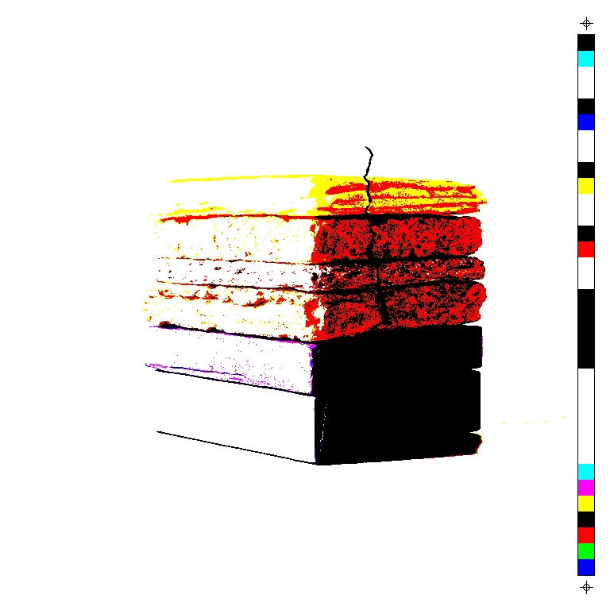

# Oblique

An image editor for making things worse.

A desktop app for macOS. A photo or a scan goes through a stack of operators,
and each one is something that happened to the image: a copier on its ninth
generation, a starved ink roller, film burnt through by the projector lamp, a
halftone screen out of register. Every operator stays live and reorderable,
so nothing is baked in until you say so.

One sample image through eight of the operators:

| | | | |
|:-:|:-:|:-:|:-:|
| <a href="docs/nodes/op.cmyk_halftone.md"></a><br>CMYK Halftone | <a href="docs/nodes/op.xerox.md"></a><br>Copy of a Copy | <a href="docs/nodes/op.hatch.md"></a><br>Hatch | <a href="docs/nodes/op.film_burn.md"></a><br>Film Burn |
| <a href="docs/nodes/op.technicolor.md"></a><br>Dye Transfer | <a href="docs/nodes/op.edge_noise.md"></a><br>Edge Noise | <a href="docs/nodes/op.grain.md"></a><br>Grain | <a href="docs/nodes/op.colour_crush.md"></a><br>Colour Crush |

---

## Download

The latest zip is on [Releases](https://github.com/preset-nz/oblique/releases). Free, pre-release, Apple Silicon (M-series) Macs only.

It isn't signed by Apple, so the first time macOS says **"Oblique.app is damaged and can't be opened"**. It isn't damaged; macOS doesn't recognise the developer. Fix it once:

1. Open Terminal (`Cmd+Space`, type `Terminal`).
2. Type `xattr -cr ` (with a trailing space), drag `Oblique.app` into the Terminal window, and press Return.
3. Double-click the app again. It opens from then on.

---

## Use it

`Shift-Cmd-I` imports an image as a layer. With a layer selected, **Add
modifier** puts an operator on it; drag its controls and the canvas follows. Operators reorder by
dragging, and each one can be switched off.

`Cmd-S` saves an `.oblique` file and `Cmd-O` opens one. **File → Export PNG…**
writes the result.

What each operator does, with examples, is in [docs/nodes](docs/nodes/README.md).

---

## Build it

To build it from source instead:

**Prerequisites**
[Rust](https://rustup.rs), [Node](https://nodejs.org),
[pnpm](https://pnpm.io), [uv](https://docs.astral.sh/uv/),
[just](https://github.com/casey/just), and the Xcode Command Line Tools
(`xcode-select --install`). `just prep` reports what is installed.

```sh
just install     # dependencies, including the Python sidecar and its native kernels
just run         # the app
```

`just build` makes a release bundle. `just check` runs the tests, linters and
licence gate.

---

## Licence

[MIT](LICENSE).

---

*Oblique, after Virilio's "oblique function": nothing here stands upright on purpose.*
