# Oblique nodes

<!-- generated whole by preset-docs; write in the node pages, not here -->

## Document

- [Document](document.md): The canvas everything is built on: its size, background and notes.

## Layer

- [Pixel layer](pixel.md): A picture, such as a photo you've opened.
- [Text layer](text.md): Typed words in any installed font, which can also mask other layers.
- [Vector layer](vector.md): Drawn shapes with smooth edges, which can also mask other layers.

## Modifier

| | Node | What it does |
|---|---|---|
| 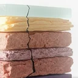 | [Bloom](op.bloom.md) | Bright areas bleed light into their surroundings. |
| 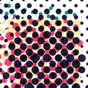 | [CMYK Halftone](op.cmyk_halftone.md) | Prints the picture as the four dot screens of CMYK, at the classic angles, with optional misregistration and inks you can swap for spot-colour and riso looks. |
| 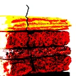 | [Colour Crush](op.colour_crush.md) | Per-channel bit-depth reduction — posterise's meaner sibling, with optional Bayer dither. |
| 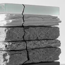 | [Colour keep](op.colour_keep.md) | Turn everything greyscale except the chosen colours. |
| 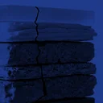 | [Colourise](op.colourise.md) | Tint the image with a single ink, keeping the source luminance. |
| 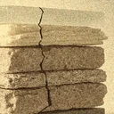 | [Desaturate](op.desaturate.md) | Blend the image toward Rec. 709 greyscale by a chosen amount. |
| 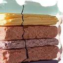 | [Dilate](op.dilate.md) | Grow the layer's shape outward, carrying its edge colour with it. |
| 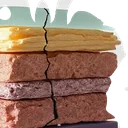 | [Edge Noise](op.edge_noise.md) | Tear and crumble the layer's edge — the interior stays solid. |
| 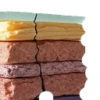 | [Erode](op.erode.md) | Eat the layer's shape inward from its edge. |
| 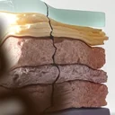 | [Film Burn](op.film_burn.md) | The film stalls in the gate: a blister bubbles up, the emulsion chars, the image burns through. |
| 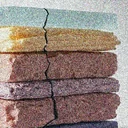 | [Film stock](op.film_stock.md) | Grades the picture like a named film stock: tone curves with lifted blacks, a colour cross-mix, split-toned shadows and highlights, a vignette and grain. |
| 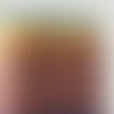 | [Gaussian Blur](op.gaussian_blur.md) | Even, soft blur across the RGB channels — alpha stays untouched. |
| 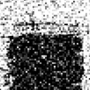 | [Grain](op.grain.md) | Seeded, chunky film-grain noise added to the RGB channels. |
| 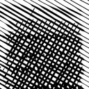 | [Hatch](op.hatch.md) | Redraw tone as pen marks — hatched lines, dashes, crosses or stipple dots whose density follows the image's darkness. Layers stack crosshatch; one layer engraves. |
| 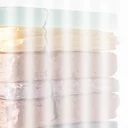 | [Ink Starved](op.ink_starved.md) | The printer running dry: ink coverage fades along one axis, with worn-roller banding. |
| 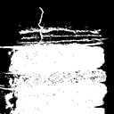 | [Invert](op.invert.md) | Photographic negative of the RGB channels; alpha untouched. |
| 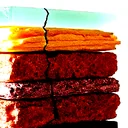 | [Levels](op.levels.md) | Classic black/white/gamma tonal remap via a single LUT. |
| 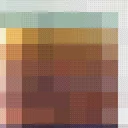 | [Pixelate](op.pixelate.md) | Flat-mean square-cell mosaic — each cell renders as one solid colour. |
| 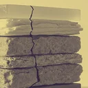 | [Recolour](op.recolour.md) | Remap luminance onto an ordered 2-4 colour ramp — the duotone/tritone workhorse. |
| 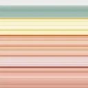 | [Smear](op.smear.md) | The scanner head stalled: sample one row or column and repeat it across the frame. |
| 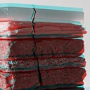 | [Technicolor](op.technicolor.md) | Dye-transfer colour from old three-strip and two-strip film: saturated reds, teal-cyans and slightly unreal skin, with the colour records printed a touch out of register. |
| 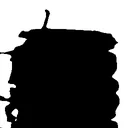 | [Threshold](op.threshold.md) | Hard (or smoothstepped) luminance cut to pure black and white. |
| 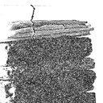 | [Xerox](op.xerox.md) | Copy-of-a-copy generation loss: contrast blowout, threshold drift, skew, toner speckle. |
