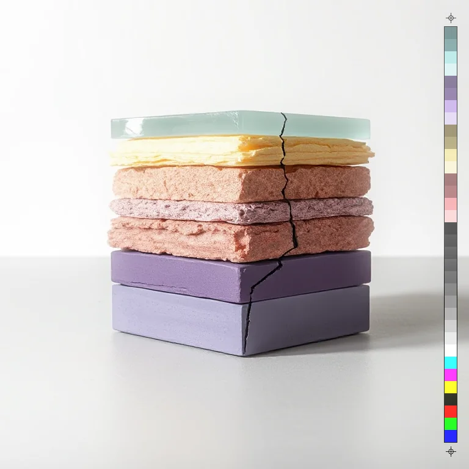
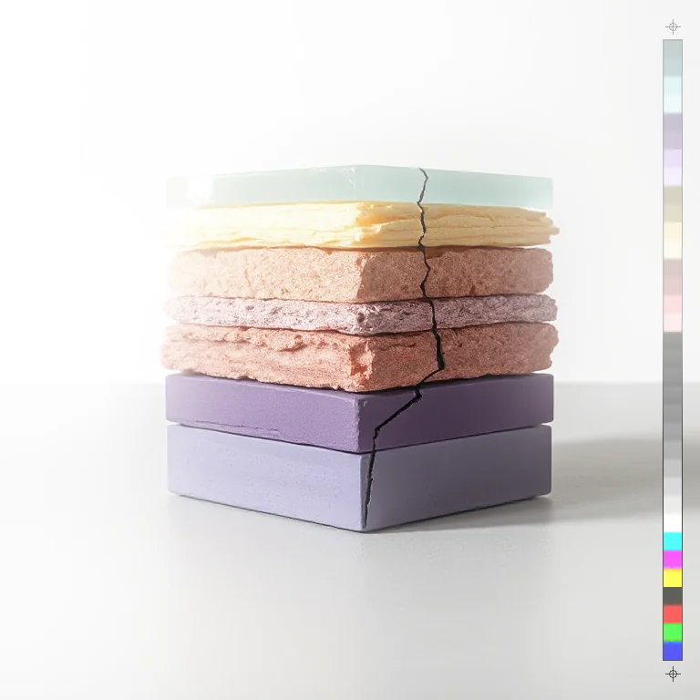

# Bloom

<!-- generated:begin — preset-docs rewrites this block; write outside it -->
Bright areas bleed light into their surroundings.

| Control | Range | Default | What it does |
|---|---|---|---|
| Enabled | on or off | on | Turns the effect on or off without losing its settings. |
| Threshold | 0 to 1, or more | 0.7 | Brightness above which pixels glow, 0 to 1. Lower lets more of the image bloom. |
| Radius | 0 to 200, or more | 24 | How far the glow spreads, in document pixels. Larger is a wider, softer glow. |
| Intensity | 0 to 2, or more | 0.8 | Strength of the glow. Higher is brighter; 0 turns it off. |
| Blend | screen, add | screen | How the glow combines with the image: screen only lightens, add blows out to white faster. |
| Glow past edge | on or off | off | Lets the glow spread beyond the layer's edge into transparent areas. |

Slots: `mask`.
<!-- generated:end -->

## Using it

Bright parts of the picture bleed light into what is around them, like the glow around a lamp. Dark parts and mid-tones do not glow.

- **Threshold** is how bright a pixel must be, 0 to 1, before it glows. The glow is strongest for the brightest pixels and eases in from the Threshold. Lower it to let more of the picture glow. At 1 nothing glows.
- **Radius** is how far the glow spreads, in document pixels. Larger is wider and softer. At 0 nothing happens.
- **Intensity** is the strength of the glow, to 2. At 0 it is off.
- **Blend** is how the glow is combined with the picture. screen can only lighten and never goes past white. add piles the glow on and goes to white quickly. With screen, a high Intensity stops adding once the glow is at full strength; with add it keeps going.
- **Glow past edge** lets the glow spread beyond the layer's edge into transparent space. Off, the glow stays inside the layer's visible pixels and alpha is untouched. On, the glow adds to alpha around the shape, as light spills off a cutout.

The glow takes the colour of the bright pixels it comes from, so a red lamp glows red.

## Recipes

- **Night street.** Bloom with Threshold 0.8, Radius 40, Intensity 1.0, on a photo with lit windows.
- **Neon text.** On a text layer with a pale pink Fill, Bloom with Threshold 0.4, Radius 30, Intensity 1.2 and Glow past edge on. The glow spreads around the letters.
- **Burning frame.** Film Burn with Burn-through white, then Bloom with Threshold 0.9 and Radius 30.

## Examples

<!-- examples:begin — `just examples` rewrites this block; write outside it -->

*Defaults.*

*Everything glows: Bloom (Threshold 0.7, Radius 60, Intensity 1.5, Blend screen).*
<!-- examples:end -->
