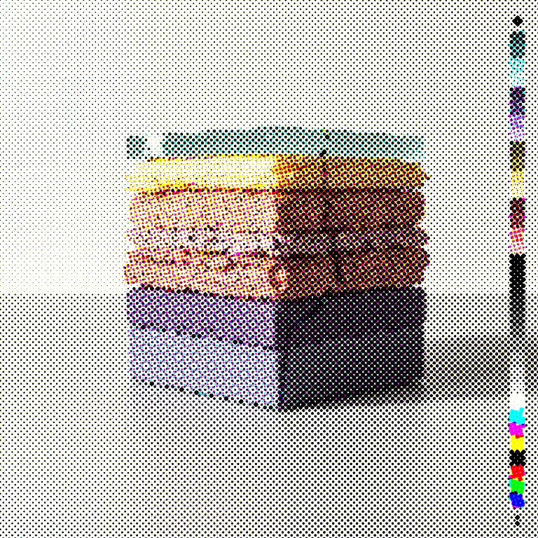
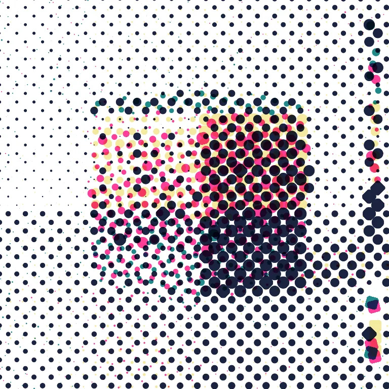

# CMYK Halftone

<!-- generated:begin — preset-docs rewrites this block; write outside it -->
Prints the picture as the four dot screens of CMYK, at the classic angles, with optional misregistration and inks you can swap for spot-colour and riso looks.

| Control | Range | Default | What it does |
|---|---|---|---|
| Enabled | on or off | on | Turns the effect on or off without losing its settings. |
| Dot size | 1 to 200, or more | 6 | Spacing between dot centres in document pixels. Larger is coarser dots. |
| Cyan angle | 0 to 90, or more | 15 | Rotation of the cyan dot screen in degrees. |
| Magenta angle | 0 to 90, or more | 75 | Rotation of the magenta dot screen in degrees. |
| Yellow angle | 0 to 90, or more | 0 | Rotation of the yellow dot screen in degrees. |
| Black angle | 0 to 90, or more | 45 | Rotation of the black dot screen in degrees. |
| Cyan ink | text | #00ffff | Colour the cyan plate is printed in. |
| Magenta ink | text | #ff00ff | Colour the magenta plate is printed in. |
| Yellow ink | text | #ffff00 | Colour the yellow plate is printed in. |
| Black ink | text | #000000 | Colour the black plate is printed in. |
| Misregistration | 0 to 8, or more | 0 | Largest random shift of each ink plate, in document pixels. 0 keeps the plates aligned. |
| Seed | 0 to 2147483647, or more | 0 | Changes the random pattern without changing its character. |
| Mode | paper, over | paper | paper prints the dots on white paper; over prints them on top of the original image. |
| Paper is transparent | on or off | off | Makes the paper transparent so the dots overprint the layers below. Paper mode only. |
| Dots past edge | on or off | off | Samples the dots from the layer's tone over paper, so they carry on past its edge. Needs Paper is transparent, in paper mode. |

Slots: `mask`.
<!-- generated:end -->

## Using it

Prints the picture as the dot screens of four-colour printing. Each of cyan, magenta, yellow and black is a separate screen of round dots; darker areas get bigger dots. Close up it is dots, at a distance the colours mix. It is the look of a newspaper, a comic or a cheap flyer.

**Screens and angles.** In print, each ink's screen is tilted so the four do not line up and produce a moiré. The defaults are the classic ones: cyan 15 degrees, magenta 75, yellow 0 and black 45. Setting two angles equal makes those two screens sit on top of each other.

**Inks are yours.** The picture is always split into the same four plates. What colour each plate is printed in is a separate choice: Cyan ink, Magenta ink, Yellow ink and Black ink. Swapping them gives spot-colour looks. A risograph prints each ink in its own pass, with inks such as a fluorescent pink and a teal; set the four inks to match.

- **Dot size** is the spacing between dot centres in document pixels. Larger is coarser.
- **Misregistration** shifts each plate by a random amount up to this many pixels, so the colours no longer line up. The shifts are seeded and keep their directions as you change the amount.
- **Mode** paper prints on white paper and discards the picture's own colour. over prints the dots on top of the original picture and darkens it.
- **Paper is transparent** removes the white of the paper, so only the dots remain and they overprint the layers below. It works in paper mode only. Alpha becomes the layer's own alpha times the dots, so the dots are cut to the layer's outline.
- **Dots past edge** needs Paper is transparent. The dots are sampled from the layer's tone over paper and no longer cut to the outline, so the screen carries on past the edge of the shape and a dot at the edge is whole instead of sliced. It is ignored in over mode.

The separation is a simple one: black takes the darkest part of each pixel and the other three share what is left. Grey comes out as black dots alone.

## Recipes

- **Process print.** The defaults with Dot size 5, on a photo.
- **Riso pink and teal.** Cyan ink a teal, Magenta ink a fluorescent pink, Yellow ink a pale yellow, Black ink a dark navy. Dot size 8.
- **Misprint over the original.** Mode over, Dot size 10, Misregistration 3.
- **Dots over the original.** Paper is transparent on, on a duplicate layer stacked above the original: the dots lie over the unchanged picture.

## Examples

<!-- examples:begin — `just examples` rewrites this block; write outside it -->

*Defaults.*

*Big riso dots, out of register: CMYK Halftone (Cyan ink #1f8a8a, Magenta ink #ff3d9a, Yellow ink #f5e9a0, Black ink #1b2440, Dot size 24, Misregistration 6).*
<!-- examples:end -->
