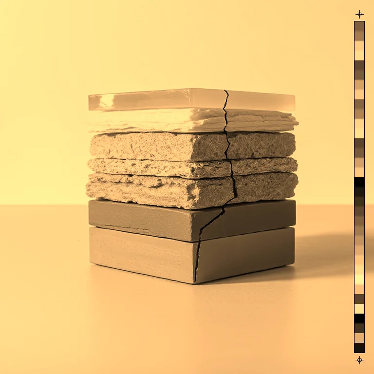
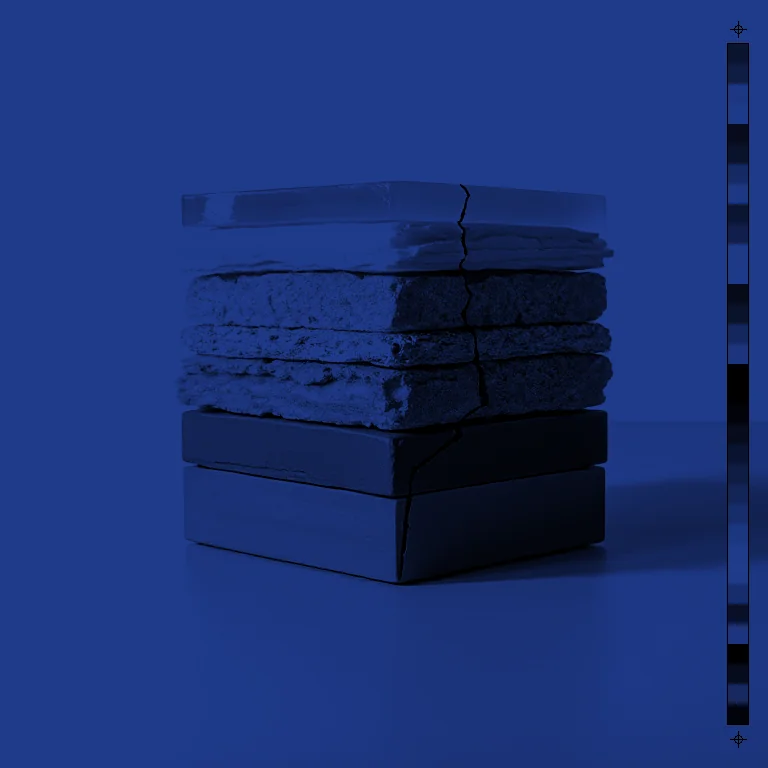

# Colourise

<!-- generated:begin — rhizome-docs rewrites this block; write outside it -->
Tint the image with a single ink, keeping the source luminance.

| Control | Range | Default | What it does |
|---|---|---|---|
| Enabled | on or off | on | Turns the effect on or off without losing its settings. |
| Colour | text | #7a5c3a | The ink the image is tinted with. |
| Amount | 0 to 1, or more | 1 | Strength of the tint. 0 leaves the image unchanged; 1 is fully tinted. |
| Keep brightness | on or off | on | Rescales the tinted result so each pixel keeps its original brightness. Off gives a darker, classic tint. |

Slots: `mask`.
<!-- generated:end -->

## What it's for

Throws away the picture's own hues and paints it in one colour, with the lights and darks of the original. Think of printing a photograph in a single ink.

- **Colour** is the ink.
- **Amount** blends between the original (0) and the full tint (1).
- **Keep brightness** is on by default: each pixel keeps the brightness it had, so the picture does not get darker. With a dark ink the lightest areas may not reach pure white and come out as a lighter tint of it. Off, the tint multiplies the picture's brightness by the ink: white becomes exactly the ink colour and everything else is darker. That is the classic single-ink look, and a dark ink gives a dark picture.

A vector layer draws white, so on one, turn Keep brightness off to get the shape in the ink colour itself. With it on, the colour comes out lighter than the swatch.

Alpha is untouched.

## Recipes

- **Sepia.** Colourise with the default brown at Amount 1 and Keep brightness on, then Grain.
- **Cyanotype.** Levels to set the contrast, then Colourise with a deep blue and Keep brightness off: whites become that blue and blacks stay black.
- **Coloured shape.** On a vector layer, Colourise with any Colour and Keep brightness off.

## Examples

<!-- examples:begin — `just examples` rewrites this block; write outside it -->

*Defaults.*

*Cyanotype: Levels (Black point 40, White point 215), then Colourise (Colour #1f3a8a, Keep brightness off).*
<!-- examples:end -->
