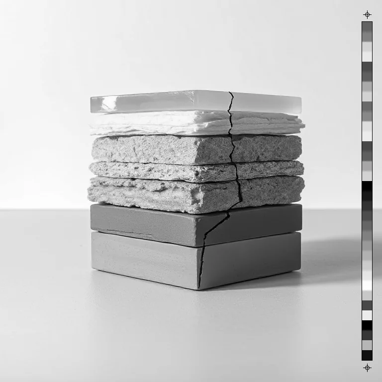
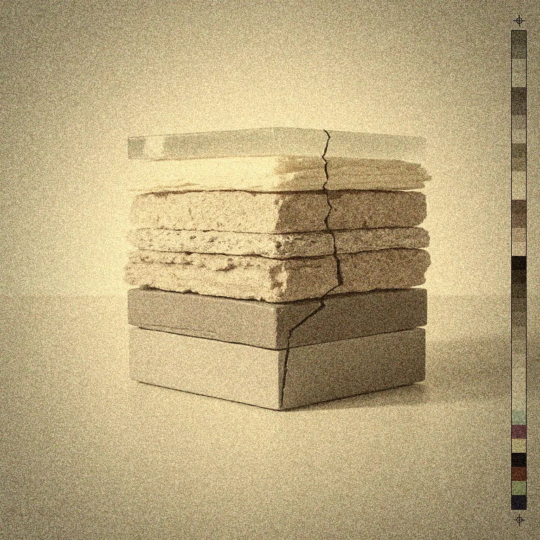

# Desaturate

<!-- generated:begin — preset-docs rewrites this block; write outside it -->
Blend the image toward Rec. 709 greyscale by a chosen amount.

| Control | Range | Default | What it does |
|---|---|---|---|
| Enabled | on or off | on | Turns the effect on or off without losing its settings. |
| Amount | 0 to 1, or more | 1 | How far colour is pulled toward greyscale. 0 leaves the image unchanged; 1 is full greyscale. |

Slots: `mask`.
<!-- generated:end -->

## Using it

Pulls each pixel's colour toward its grey. At Amount 1 the picture is greyscale; at 0 nothing changes; in between it is a faded version of the original. Grey here is Rec. 709 luma, so green counts most and blue least: a pure green looks light, a pure blue looks dark.

There is no separate greyscale op. Desaturate at 1 is it.

## Recipes

- **Faded print.** Desaturate at Amount 0.5, then Film stock with the sx70 stock.

## Examples

<!-- examples:begin — `just examples` rewrites this block; write outside it -->

*Defaults.*

*Faded to almost nothing: Desaturate (Amount 0.85), then Film stock (Stock sx70, Vignette 1, Grain 1).*
<!-- examples:end -->
