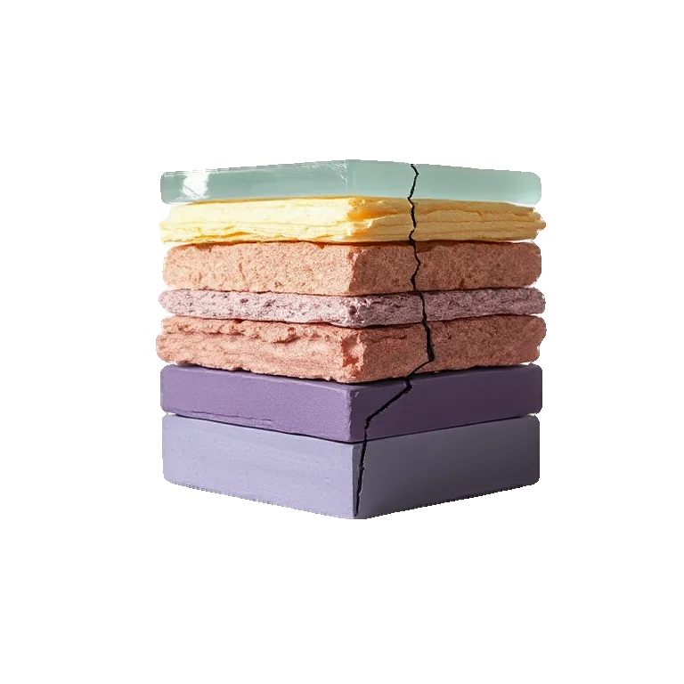
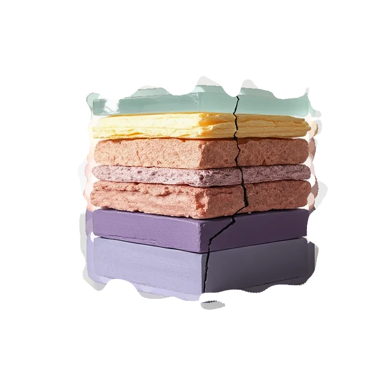

# Dilate

<!-- generated:begin — preset-docs rewrites this block; write outside it -->
Grow the layer's shape outward, carrying its edge colour with it.

| Control | Range | Default | What it does |
|---|---|---|---|
| Enabled | on or off | on | Turns the effect on or off without losing its settings. |
| Radius | 0 to 64, or more | 2 | How far the shape grows outward, in document pixels. 0 does nothing. |

Slots: `mask`.
<!-- generated:end -->

## Using it

Grows the layer's shape outward by Radius, measured in document pixels. It works on alpha, the shape's coverage, so it needs transparency to act on: on a fully opaque layer there is no edge and nothing happens. Use it on text, on a vector layer, or on a cutout.

The new pixels take their colour from the shape beside them, so the grown edge carries the shape's colour outward. The footprint is round, not square, so corners grow round rather than boxy. Radius can be fractional and the edge moves smoothly: a soft-edged shape stays soft.

Dilate is also how a mask is made bigger. On a layer set to output a mask, Dilate grows the area it reveals. The binding on a modifier's mask has Expand for the same job.

## Recipes

- **Fatten the letters.** On a text layer, Dilate at Radius 3.
- **Chunky torn edge.** Dilate at Radius 4, then Edge Noise at Amount 0.6 and Feature size 20: the noise bites into the grown edge.
- **Close small gaps.** Dilate then Erode at the same Radius fills small gaps and holes and keeps the overall size.

## Examples

<!-- examples:begin — `just examples` rewrites this block; write outside it -->

*Defaults.*

*Swollen and torn: Dilate (Radius 14), then Edge Noise (Amount 0.8, Feature size 30).*
<!-- examples:end -->
