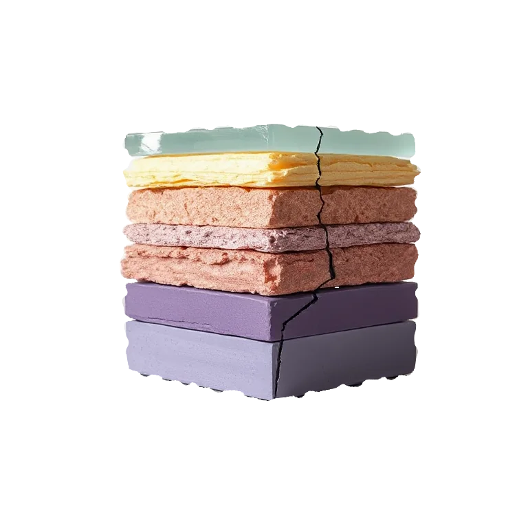
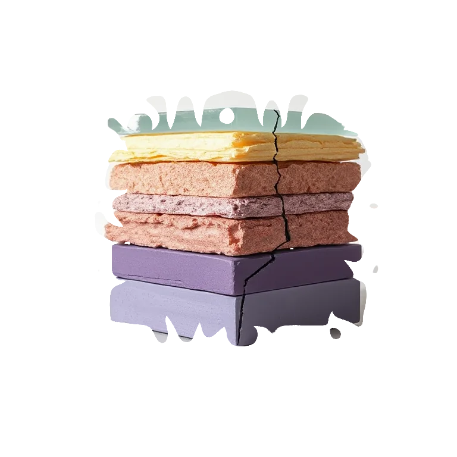

# Edge Noise

<!-- generated:begin — preset-docs rewrites this block; write outside it -->
Tear and crumble the layer's edge — the interior stays solid.

| Control | Range | Default | What it does |
|---|---|---|---|
| Enabled | on or off | on | Turns the effect on or off without losing its settings. |
| Amount | 0 to 1, or more | 0.4 | How far the edge is pushed around, as a proportion of Feature size. Higher is rougher; 0 does nothing. |
| Feature size | 1 to 128, or more | 12 | Size of the bumps along the edge, in document pixels. Larger is broader tears. |
| Seed | 0 to 2147483647, or more | 0 | Changes the random pattern without changing its character. |
| Profile | smooth, linear, saw, rect, straight | smooth | Shape of the tears: smooth curves, linear (polygonal), saw (sharp teeth), rect (square steps) or straight (long flat rips). |

Slots: `mask`.
<!-- generated:end -->

## Using it

Roughens the boundary of a shape, as if it had been torn or had crumbled. Only the edge moves: the solid inside and the empty outside stay as they are. It acts on alpha, so it needs transparency to work with. On a fully opaque layer there is no edge and nothing happens. Use it on text, on a vector layer, or on a cutout.

- **Amount** is how far the edge is pushed, as a share of Feature size: at 1 the edge can move by a whole Feature size either way. At 0 nothing happens.
- **Feature size** is the size of the bumps along the edge, in document pixels. Small gives fine fraying; large gives broad bites.
- **Seed** picks a different tear of the same character.
- **Profile** is the shape of the tear:
  - smooth: rounded wobble.
  - linear: straight runs with a corner at each point, so the edge is polygonal.
  - saw: sharp, regularly spaced teeth.
  - rect: square steps, a pixelated edge.
  - straight: a few long flat rips with hard corners. Its features are three times coarser than the same Feature size elsewhere.

Colour is not changed, so the new edge is the same colour as the old one.

## Recipes

- **Torn paper.** On a vector layer drawn as a rectangle, Edge Noise with Amount 0.5, Feature size 14 and Profile smooth, then Grain.
- **Ragged stencil.** On a text layer set to mask, Edge Noise with Amount 0.4, Feature size 8 and Profile saw: whatever it masks is revealed through teeth.
- **Polygonal edge.** Profile linear, Feature size 30, Amount 0.3.

## Examples

<!-- examples:begin — `just examples` rewrites this block; write outside it -->

*Defaults.*

*Bitten: Edge Noise (Amount 1, Feature size 36, Profile saw).*
<!-- examples:end -->
