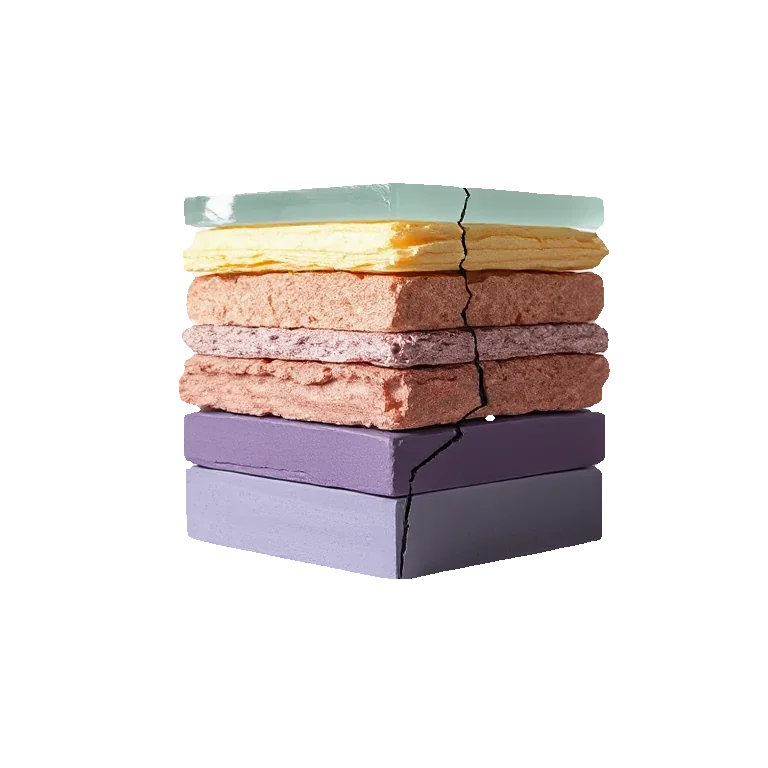
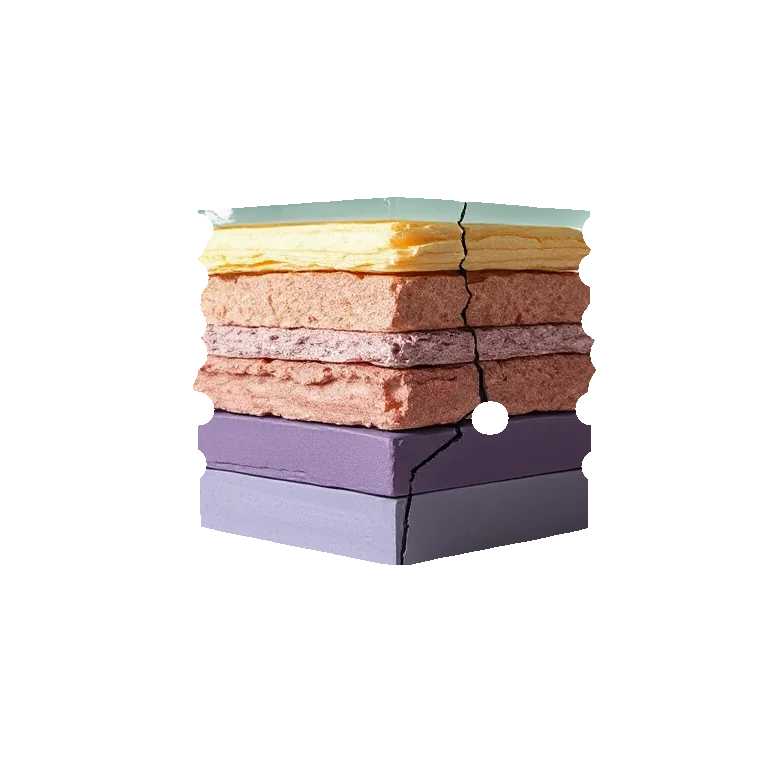

# Erode

<!-- generated:begin — preset-docs rewrites this block; write outside it -->
Eat the layer's shape inward from its edge.

| Control | Range | Default | What it does |
|---|---|---|---|
| Enabled | on or off | on | Turns the effect on or off without losing its settings. |
| Radius | 0 to 64, or more | 2 | How far the shape's edge eats inward, in document pixels. 0 does nothing. |

Slots: `mask`.
<!-- generated:end -->

## Using it

Eats the layer's shape inward from its edge by Radius, in document pixels. It works on alpha, so it needs transparency: on a fully opaque layer there is no edge and nothing happens. Use it on text, on a vector layer, or on a cutout.

The colour of what remains is untouched; pixels that lose coverage become transparent. The footprint is round, so corners stay round. Radius can be fractional and the edge moves smoothly, so a soft-edged shape stays soft.

Details thinner than twice the Radius disappear. Raising Radius on text first thins the strokes, then removes the narrowest ones.

## Recipes

- **Thin the letters.** On a text layer, Erode at Radius 1.5.
- **Clean up specks.** Erode then Dilate at the same Radius removes specks and thin spurs and keeps the overall size.
- **Worn mask.** On a vector layer set to mask, Erode at Radius 6 and then Edge Noise: the clipped area shrinks and gets a rough rim.

## Examples

<!-- examples:begin — `just examples` rewrites this block; write outside it -->

*Defaults.*

*Eaten away: Erode (Radius 16).*
<!-- examples:end -->
