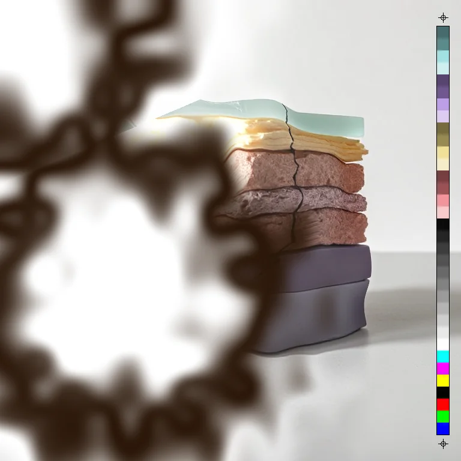

# Film Burn

<!-- generated:begin — rhizome-docs rewrites this block; write outside it -->
The film stalls in the gate: a blister bubbles up, the emulsion chars, the image burns through.

| Control | Range | Default | What it does |
|---|---|---|---|
| Enabled | on or off | on | Turns the effect on or off without losing its settings. |
| Progress | 0 to 1, or more | 0 | How far the burn has spread. 0 leaves the image untouched; 1 burns the whole frame through. |
| Hot spots | 1 to 4, or more | 1 | Number of places the burn starts from. |
| Irregularity | 0 to 1, or more | 0.5 | How ragged the burn front is. 0 is a smooth circle; higher is more uneven. |
| Feature size | 1 to 128, or more | 24 | Size of the bumps in the burn front, in document pixels. Larger is a broader wobble. |
| Blister | 0 to 1, or more | 0.6 | How far the image bulges outward ahead of the burn. 0 is flat; higher pushes harder. |
| Char width | 0 to 1, or more | 0.4 | Width of the blister and scorched bands around the burn. Higher is a wider scorched edge. |
| Char colour | text | #2a1608 | Colour of the scorched band. |
| Burn-through | white, transparent | white | What the fully burnt area becomes: white, or transparent so layers below show through. |
| Seed | 0 to 2147483647, or more | 0 | Changes the random pattern without changing its character. |

Slots: `mask`.
<!-- generated:end -->

## What it's for

Plays one frame of film burning in a projector gate. A blister swells up, the emulsion chars, and a hole opens that grows until the whole frame is gone. It is built to be scrubbed: **Progress** is the time axis.

**Progress starts at 0, and at 0 the op does nothing.** Drag it up and the burn grows out from its starting points. At 1 the whole frame has burnt through.

**Four zones, from the clean image inward.**

- Intact: untouched.
- Blister: the picture bulges outward away from the burn, and goes a little lighter and less colourful.
- Scorch: the picture is replaced by the **Char colour**.
- Burn-through: **Burn-through** decides what is left. White makes the hole white, as if it were the projector lamp, and keeps the layer's alpha. Transparent clears alpha so the layers below show through the hole.

The zones blend smoothly into each other.

- **Hot spots** is how many places the burn starts from, 1 to 4. You don't place them: they come from Seed, so change Seed to move them. At a given seed the first hot spot stays put as the count goes up, so more hot spots only add.
- **Irregularity** is how ragged the front is. At 0 it is a clean circle around each hot spot; higher is uneven.
- **Feature size** is the size of the bumps in the front, in document pixels.
- **Blister** is how hard the picture bulges. 0 is flat, 1 pushes it by up to a twentieth of the frame's diagonal. It fades once a pixel has charred.
- **Char width** is how wide the blister and scorch bands are. At 0 they are thin; at 1 each is up to a quarter of the diagonal.
- **Seed** moves the hot spots and the shape of the front.

Alpha is changed only by Blister, which moves it with the picture, and by Burn-through set to transparent.

## Recipes

- **Burn in progress.** Progress 0.35, Hot spots 1, Irregularity 0.6, defaults otherwise, then Bloom with Threshold 0.9 and Radius 30 so the hole glows.
- **Burn through to the layer below.** Burn-through transparent, Progress 0.6, over a second picture. The second shows through the hole.
- **Several fires.** Hot spots 3, Progress 0.3, Blister 0.3, Char width 0.2, Irregularity 0.8.

## Examples

<!-- examples:begin — `just examples` rewrites this block; write outside it -->

*Burnt through: Film Burn (Progress 0.3, Hot spots 2, Irregularity 0.1, Feature size 48), then Bloom (Threshold 0.9, Radius 40).*
<!-- examples:end -->
