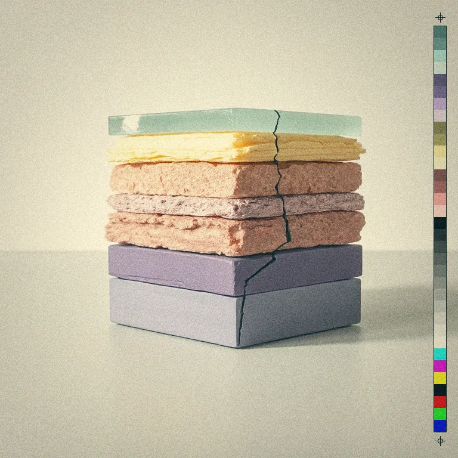
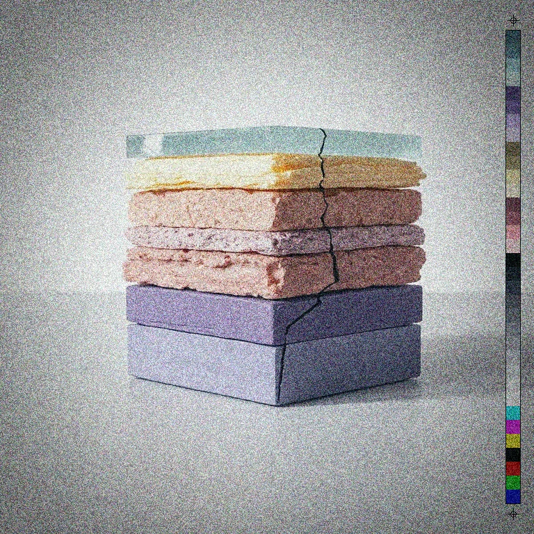

# Film stock

<!-- generated:begin — preset-docs rewrites this block; write outside it -->
Grades the picture like a named film stock: tone curves with lifted blacks, a colour cross-mix, split-toned shadows and highlights, a vignette and grain.

| Control | Range | Default | What it does |
|---|---|---|---|
| Enabled | on or off | on | Turns the effect on or off without losing its settings. |
| Stock | Instant (`polaroid_600`), Instant, Faded (`sx70`), Cross Process (`cross_process`), Bleach Bypass (`bleach_bypass`), Expired (`expired`) | Instant (`polaroid_600`) | Instant: milky lifted blacks, cyan-green shadows, warm creamy highlights, low contrast. Instant, Faded: warmer and more faded, with amber highlights and brown shadows. Cross Process: slide film in the wrong chemistry, with hard contrast, blue shadows and yellow-green highlights. Bleach Bypass: silver left in, so the colour is mostly gone and the contrast is hard and metallic. Expired: faded old stock with a seeded colour shift and a magenta or cyan cast. |
| Amount | 0 to 1, or more | 1 | How much of the stock's colour grade is mixed in. 0 leaves the colours as they were; 1 is the full stock. Vignette and grain have their own sliders. |
| Grain | 0 to 1, or more | 0.5 | Film grain, as a share of the stock's own. 1 is the stock's full grain; 0 is none. The specks keep the same size relative to the picture at any resolution. |
| Vignette | 0 to 1, or more | 0.5 | Edge darkening, as a share of the stock's own. 1 is the stock's full vignette; 0 is none. It follows the frame, so it looks the same at any resolution. |
| Seed | 0 to 2147483647, or more | 0 | Changes the grain pattern and, for expired, the colour shift and which cast it gets. |

Slots: `mask`.
<!-- generated:end -->

## Using it

Grades the picture the way a particular photographic film would have rendered it. Each stock is a set of tone curves, a colour mix, a tint in the shadows and a tint in the highlights, plus its own vignette and its own grain. One op, five stocks.

**The stocks.**

- **Instant**: milky lifted blacks that lean cyan-green, creamy highlights, low contrast. The instant-film snapshot.
- **Instant, Faded**: warmer and more faded than Instant, with brown shadows and amber highlights. The look of the folding instant cameras of the 1970s.
- **cross_process**: slide film developed in the chemistry meant for colour negative film, which was done on purpose for its look. Hard contrast, blue shadows, yellow-green highlights, saturated colour.
- **bleach_bypass**: a lab step that leaves the silver in the print, which strips colour and hardens contrast. Mostly grey, hard and metallic, with grain that carries no colour.
- **expired**: old film with a faded base. Its colour shift and its cast, magenta or cyan, are picked by Seed, so each seed is a different roll.

**What each control does.**

- **Amount** is how much of the stock's colour grade is applied. 0 leaves the colours as they were, 1 is the full stock.
- **Vignette** darkens toward the corners. It is a share of the stock's own depth, which differs by stock: 1 is the stock's full vignette, 0 is none. It follows the frame, so it looks the same at any size.
- **Grain** is film grain as a share of the stock's own. The specks are sized relative to the whole picture, so a small preview shows the same texture as the full-size render. Grain is strongest in the midtones, and bleach_bypass is the only stock whose grain is grey.
- **Seed** changes the grain pattern and, on expired, the colour shift and cast.

**Amount does not switch the look off.** Vignette and Grain are independent of Amount. At Amount 0 the colours are untouched but the vignette and grain still apply at their own settings. To turn the op off, use its Enabled switch, or set all three to 0.

Alpha is untouched.

## Recipes

- **Faded snapshot.** Film stock with Instant, Amount 1, Vignette 0.7, Grain 0.4.
- **Grade only.** Film stock with cross_process, Vignette 0 and Grain 0, then Grain with Amount 0.1 and Grain size 2, so the grain size is in pixels, not tied to the frame.
- **Gritty.** Film stock with bleach_bypass, Vignette 0.8, Grain 0.8: a hard, grey picture with a coarse mono grain.
- **Another roll.** Film stock with expired and change Seed until the cast suits the picture.

## Examples

<!-- examples:begin — `just examples` rewrites this block; write outside it -->

*Defaults.*

*Expired roll: Film stock (Stock Expired, Vignette 1, Grain 1, Seed 3).*
<!-- examples:end -->
