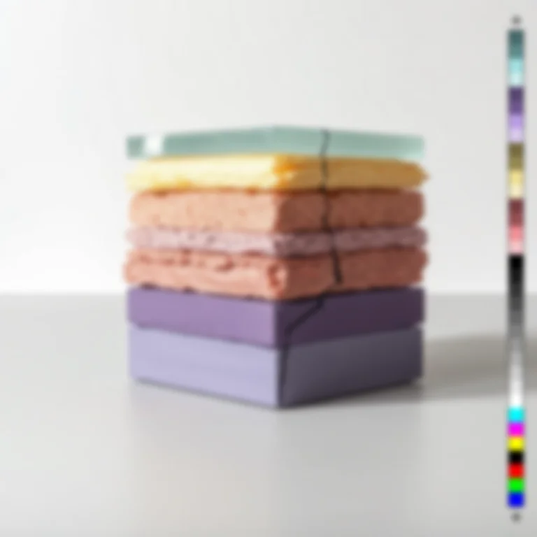
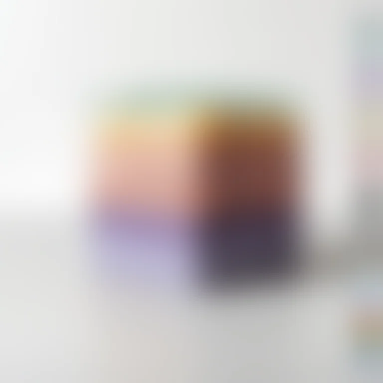

# Gaussian Blur

<!-- generated:begin — preset-docs rewrites this block; write outside it -->
Even, soft blur across the RGB channels — alpha stays untouched.

| Control | Range | Default | What it does |
|---|---|---|---|
| Enabled | on or off | on | Turns the effect on or off without losing its settings. |
| Radius | 0 to 100, or more | 4 | Blur radius in document pixels. Larger is softer; 0 does nothing. |

Slots: `mask`.
<!-- generated:end -->

## Using it

A soft, even blur of the colour. Radius is in document pixels and the preview scales it, so a draft and a full-size render show the same softness. At 0 nothing happens.

**Alpha is not blurred.** On a picture with transparency the colour softens while the outline stays crisp. That also means Gaussian Blur on a mask layer does not feather the mask, because a mask reads only alpha. To soften a mask's edge, use Feather on the binding where a modifier is masked by a layer.

## Recipes

- **Hatch from broad shapes.** Gaussian Blur at Radius 6, then Hatch. The marks follow the large light and dark areas rather than the fine texture.
- **Soft focus.** Duplicate the layer, put Gaussian Blur at Radius 12 on the copy, and stack it above the sharp one with the Screen blend mode at low opacity. Bloom does this from the bright areas only.

## Examples

<!-- examples:begin — `just examples` rewrites this block; write outside it -->

*Defaults.*

*Out of focus: Gaussian Blur (Radius 30).*
<!-- examples:end -->
