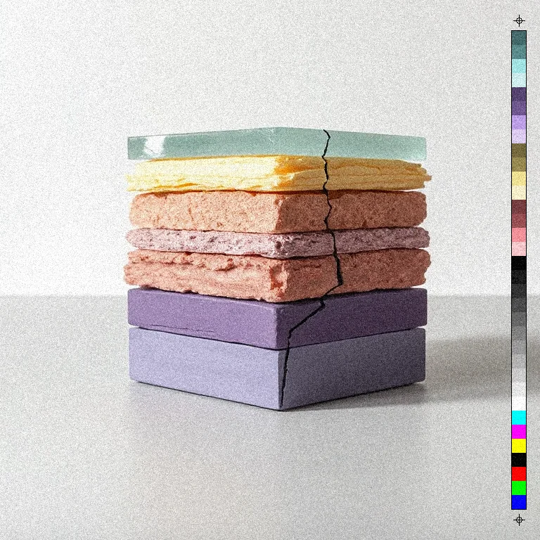
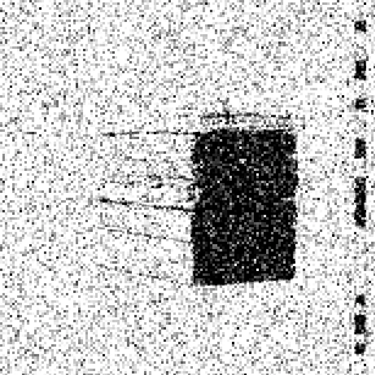

# Grain

<!-- generated:begin — preset-docs rewrites this block; write outside it -->
Seeded, chunky film-grain noise added to the RGB channels.

| Control | Range | Default | What it does |
|---|---|---|---|
| Enabled | on or off | on | Turns the effect on or off without losing its settings. |
| Amount | 0 to 1, or more | 0.1 | Strength of the noise. Higher is grainier; 0 leaves the image unchanged. |
| Grain size | 1 to 8, or more | 1 | Size of each grain speck in document pixels. Larger is chunkier. |
| Seed | 0 to 2147483647, or more | 0 | Changes the random pattern without changing its character. |

Slots: `mask`.
<!-- generated:end -->

## Using it

Adds random speckle to the picture, the same on red, green and blue, so it reads as brightness noise and does not tint. The noise is seeded: the same Seed always gives the same grain.

- **Amount** is how strong the speckle is. At 0.1 it is a fine texture. At 1 it overwhelms the picture.
- **Grain size** is the width of each speck in document pixels. Larger gives chunkier grain.
- **Seed** picks a different pattern of the same strength.

Grain follows alpha. Fully transparent pixels stay as they are and soft edges get proportionally less, so a cutout does not grow a speckled halo.

## Recipes

- **Fine film.** Film stock with Grain at 0, then Grain with Amount 0.12 and Grain size 2. Film stock's own grain is sized as a fraction of the frame; this one is sized in pixels.
- **Rough black and white.** Threshold at Level 127, Gaussian Blur at Radius 1, then Grain with Amount 0.3 and Grain size 3.

## Examples

<!-- examples:begin — `just examples` rewrites this block; write outside it -->

*Defaults.*

*Rough black and white: Threshold (Level 127), then Gaussian Blur (Radius 2), then Grain (Amount 0.6, Grain size 5).*
<!-- examples:end -->
