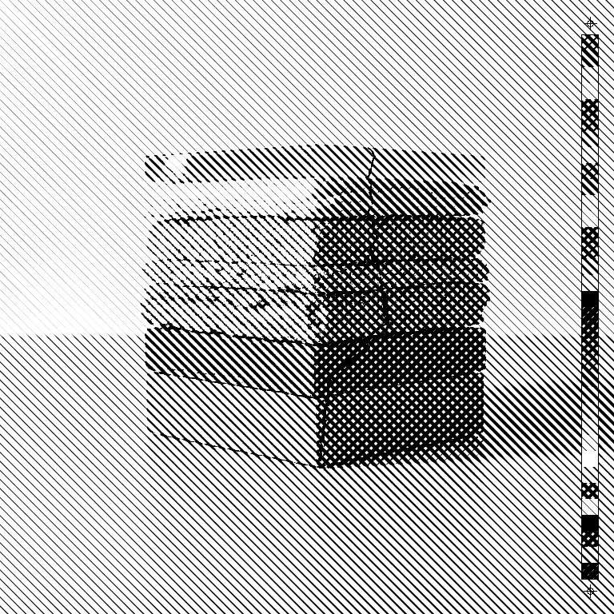
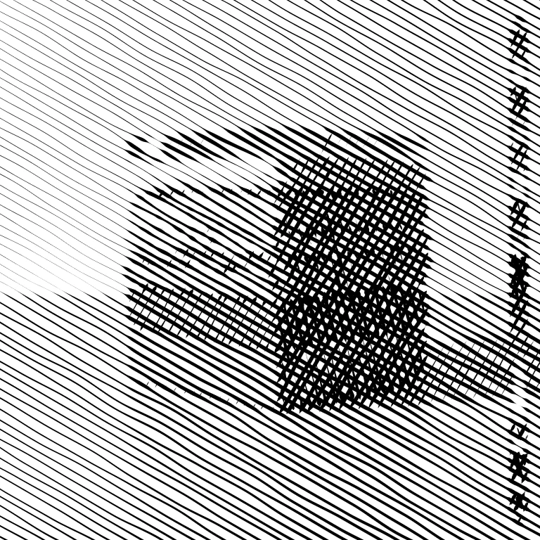

# Hatch

<!-- generated:begin — preset-docs rewrites this block; write outside it -->
Redraw tone as pen marks — hatched lines, dashes, crosses or stipple dots whose density follows the image's darkness. Layers stack crosshatch; one layer engraves.

| Control | Range | Default | What it does |
|---|---|---|---|
| Enabled | on or off | on | Turns the effect on or off without losing its settings. |
| Pattern | lines, dashes, crosses, stipple | lines | Mark style: lines, dashes, crosses or stipple dots, with density following the image's darkness. |
| Layers | 1 to 4, or more | 2 | Number of crossing mark families, 1 to 4. More layers build darker tones by crosshatching; 1 varies stroke width instead. |
| Spacing | 2 to 96, or more | 8 | Distance between marks in document pixels. Larger is coarser. |
| Angle | 0 to 180, or more | 45 | Rotation of the marks in degrees. |
| Weight | 0.05 to 1, or more | 1 | Overall ink coverage. Lower is lighter; 1 lets black close to solid. |
| Pen width | 0.01 to 1, or more | 1 | Widest a stroke may get, as a fraction of a full-width stroke. Lower draws finer lines; below 1, black no longer fills solid. |
| Jitter | 0 to 1, or more | 0 | How far marks wander from their regular position, as a fraction of spacing. 0 is perfectly regular. |
| Cross size | 0.25 to 3, or more | 1 | Arm length of each cross relative to its cell. Larger arms reach into neighbouring cells. |
| Cross aspect | 1 to 4, or more | 1 | Stretches one arm of each cross longer than the other. 1 keeps them equal. |
| Tone source | luma, red, green, blue | luma | What the marks follow: luma (overall brightness), or only the red, green or blue channel. |
| Black point | 0 to 255, or more | 0 | Input value, 0 to 255, treated as full darkness. Raising it puts more ink in the shadows. |
| White point | 0 to 255, or more | 255 | Input value, 0 to 255, treated as full lightness. Lowering it clears more of the highlights. |
| Gamma | 0.1 to 5, or more | 1 | Tone curve for the marks. Above 1 lightens the midtones, so fewer marks; below 1 darkens them. |
| Ink colour | text | #000000 | Colour of the marks. |
| Paper colour | text | #ffffff | Colour between the marks. Not used when Paper is transparent is on. |
| Paper is transparent | on or off | off | Makes the area between marks transparent so they overprint the layers below. |
| Seed | 0 to 2147483647, or more | 0 | Changes the random pattern without changing its character. |

Slots: `mask`.
<!-- generated:end -->

## Using it

Redraws the picture as pen marks. Light areas get few or thin marks, dark areas get dense or thick ones, and the original colours are gone: you see ink on paper. It is the look of pen-and-ink drawing and engraving, built from the picture's own tones.

**Hatching, crosshatching, engraving.** Hatching shades with parallel lines. Crosshatching lays a second set across the first where the tone gets darker. Engraving keeps one set of lines and swells them. **Layers** picks between these: at 1 you get a single family whose marks thicken with darkness; at 2 to 4 each extra family comes in as the tone darkens. For lines and dashes the extra families run at 90, 45 and 135 degrees from the first. For crosses and stipple the pattern is not turned: each layer shifts the grid by half a cell instead, and crosses alternate between plus and cross. The last family can close to solid black.

**What each pattern draws.**

- **lines**: unbroken strokes.
- **dashes**: strokes broken into dashes. The gaps close as it gets darker.
- **crosses**: a small plus or cross in each cell of a grid; layers alternate between the two.
- **stipple**: dots. At light tones the dots appear one at a time, at dark tones they grow until they merge.

**As you turn it.**

- **Spacing** is the distance between marks in document pixels. The marks stay the same size relative to the picture at any preview resolution.
- **Angle** turns the pattern. With lines and dashes, the other layers stay at their fixed offsets from it. With crosses and stipple it turns the grid.
- **Weight** scales the ink down overall. At 1 the darkest tones can reach solid black; lower and they stop short.
- **Pen width** caps how wide a stroke can get. Light tones are unaffected and dark ones stop fattening, so with Pen width below 1 the darkness comes from crossing layers instead of solid ink and black never fills in. It does nothing for stipple.
- **Jitter** lets marks wander off their regular positions. The wobble eases off as a layer closes, so black still fills solid. It does nothing for stipple, which always scatters its dots.
- **Cross size** and **Cross aspect** change the arms of each cross and only apply to crosses. Larger arms reach into neighbouring cells. Aspect above 1 makes one arm longer than the other.
- **Tone source** picks what the marks follow: overall brightness, or one colour channel on its own. Following red, say, draws the marks from how much red there is.
- **Black point**, **White point** and **Gamma** set how tone maps to marks, the same way Levels does. Raise Black point to put ink in more of the shadows; lower White point to clear the highlights; Gamma above 1 gives fewer marks in the midtones.
- **Ink colour** and **Paper colour** are what the marks and the gaps are painted in.
- **Paper is transparent** removes the paper: only the marks remain, so they overprint the layers below.
- **Seed** changes where dashes start and where stipple dots land, and the wobble when Jitter is above 0. Lines and crosses at Jitter 0 ignore it.

**Flat areas give flat marks.** Hatch reads tone from the layer's pixels. A layer of one flat colour, such as a vector shape that draws plain white, has the same tone everywhere and produces an even field or nothing at all. Give it a tone first: on a text layer set the Fill to the shade you want, or run Colourise with Keep brightness off ahead of Hatch.

## Recipes

- **Pen drawing.** Hatch with Pattern lines, Layers 3, Spacing 6, Angle 30, Pen width 0.5, after Gaussian Blur at Radius 2 so the marks follow shapes rather than texture.
- **Engraving.** Pattern lines, Layers 1, Spacing 5, Angle 0, Pen width 1.
- **Ink over colour.** Hatch with Paper is transparent on, on a duplicate layer stacked above the original: the marks lie over the unchanged picture.
- **Stipple print.** Pattern stipple, Spacing 4, Ink colour a dark brown, Paper colour a cream.

## Examples

<!-- examples:begin — `just examples` rewrites this block; write outside it -->

*Defaults.*

*Pen drawing: Gaussian Blur (Radius 3), then Hatch (Pattern lines, Layers 3, Spacing 12, Angle 30, Pen width 0.6, Jitter 0.4).*
<!-- examples:end -->
