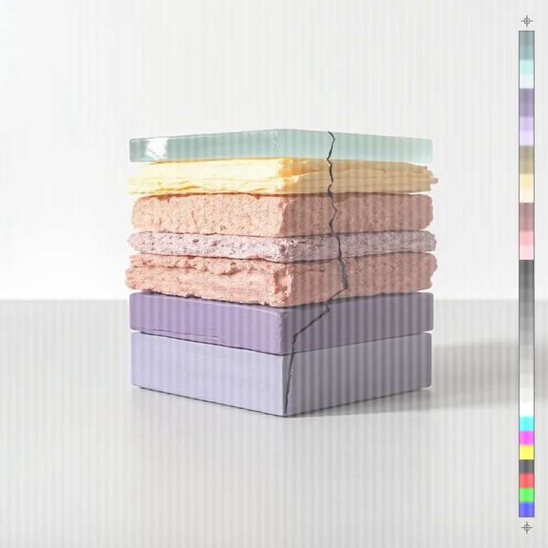
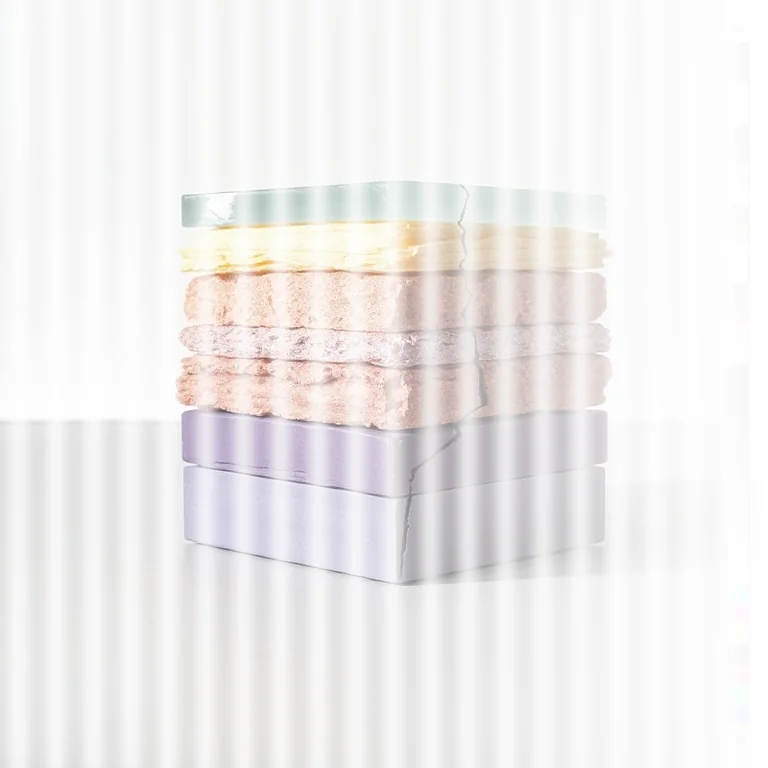

# Ink Starved

<!-- generated:begin — rhizome-docs rewrites this block; write outside it -->
The printer running dry: ink coverage fades along one axis, with worn-roller banding.

| Control | Range | Default | What it does |
|---|---|---|---|
| Enabled | on or off | on | Turns the effect on or off without losing its settings. |
| Direction | h, v | h | h fades the ink from left to right; v fades it from top to bottom. |
| Starvation | 0 to 1, or more | 0.4 | How much ink is lost by the far end, 0 to 1. Higher is paler. |
| Banding | 0 to 1, or more | 0.2 | Strength of the worn-roller stripes. Higher is stronger stripes; 0 is none. |
| Band spacing | 2 to 64, or more | 12 | Distance between stripes in document pixels. Larger is wider stripes. |
| Channel | all, c, m, y, k | all | Which ink runs dry: all of them, or only cyan (c), magenta (m), yellow (y) or black (k). |
| Seed | 0 to 2147483647, or more | 0 | Changes the random pattern without changing its character. |

Slots: `mask`.
<!-- generated:end -->

## What it's for

A printer running out of ink. The ink fades along one direction until the far end is close to blank paper, and stripes from a worn roller cut across it.

- **Direction** h fades the ink from left to right, with the full ink on the left. v fades it from top to bottom.
- **Starvation** is how much ink has gone by the far end. At 0.4 the far end is 60 per cent of the ink; at 1 it is blank. The fade is a straight ramp.
- **Banding** is the strength of the stripes. The ink rises and falls in a wave along the fade, which draws stripes at right angles to it. At 0 there are none; at 1 the thinnest part of each stripe has no ink at all.
- **Band spacing** is the distance between stripes in document pixels. The seed varies it by up to 15 per cent either way, so the actual spacing is close to this, not exact.
- **Channel** picks what runs dry. all fades every ink to white, so the picture goes pale. c, m, y or k starves one ink only, and the others print as usual, so the picture does not go pale: it takes a colour cast. Starve c and the reds come back, because cyan was what held them down. Starve k and the darks lose their weight while the colours stay.
- **Seed** changes where the stripes sit and their spacing. With Banding at 0 there are no stripes and Seed does nothing.

The ink fades to white, not to transparent. Alpha is untouched.

## Recipes

- **Dry cartridge.** Direction h, Starvation 0.7, Banding 0.3, Band spacing 20, on a photo.
- **Yellow runs out.** Channel y, Starvation 0.9, Banding 0: the far end loses its yellow and cools toward blue. Follow it with CMYK Halftone for dots that thin out.
- **Black runs out.** Channel k, Starvation 0.8: the shadows lift and go colourful toward the far end.

## Examples

<!-- examples:begin — `just examples` rewrites this block; write outside it -->

*Defaults.*

*Run dry: Ink Starved (Direction h, Starvation 1, Banding 0.7, Band spacing 36).*
<!-- examples:end -->
