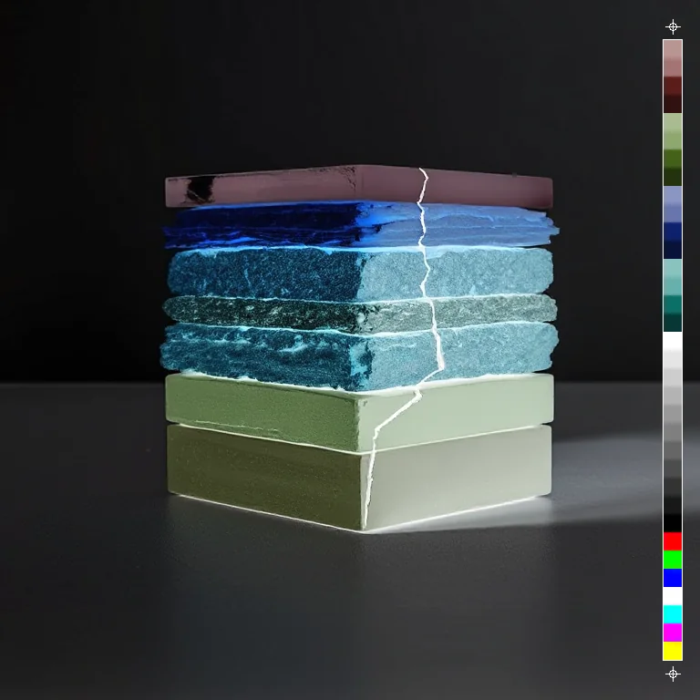
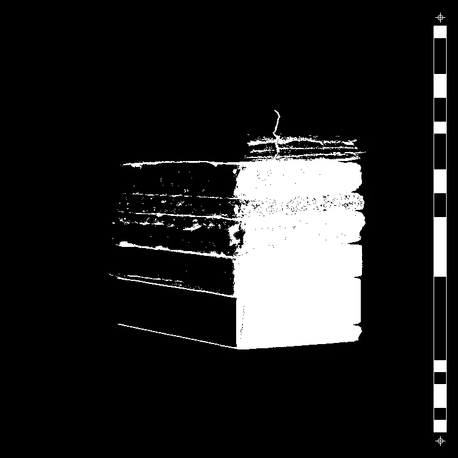

# Invert

<!-- generated:begin — preset-docs rewrites this block; write outside it -->
Photographic negative of the RGB channels; alpha untouched.

| Control | Range | Default | What it does |
|---|---|---|---|
| Enabled | on or off | on | Turns the effect on or off without losing its settings. |

Slots: `mask`.
<!-- generated:end -->

## Using it

Every red, green and blue value is flipped: black becomes white, white becomes black, a colour becomes its opposite. The result looks like a film negative. Alpha stays as it was, so a cutout keeps its outline.

Inverting twice gives back the original. Put it after Threshold to swap which side of the cut is black.

## Recipes

- **Cut and flip.** Threshold, then Invert: the same hard black and white with the sides swapped.

## Examples

<!-- examples:begin — `just examples` rewrites this block; write outside it -->

*Defaults.*

*Cut and flip: Threshold (Level 127), then Invert.*
<!-- examples:end -->
