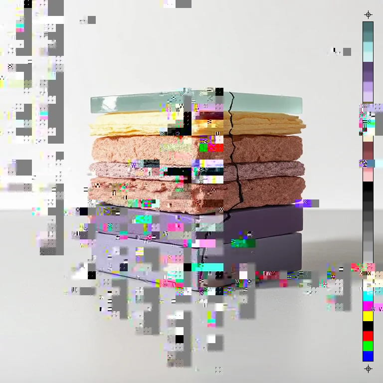
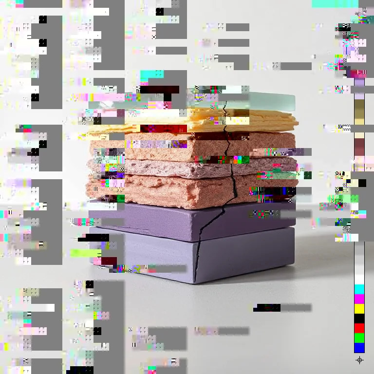

# JPEG Corrupt

<!-- generated:begin — preset-docs rewrites this block; write outside it -->
The file rots: colonies of broken JPEG blocks spread through the picture.

| Control | Range | Default | What it does |
|---|---|---|---|
| Enabled | on or off | on | Turns the effect on or off without losing its settings. |
| Progress | 0 to 1, or more | 0.35 | How much of the picture is infected. 0 leaves it untouched; 1 infects every block. |
| Colonies | 1 to 12, or more | 3 | How many places the infection starts from. |
| Spores | 0 to 1, or more | 0.15 | Share of blocks hit at random ahead of the colonies. |
| Irregularity | 0 to 1, or more | 0.6 | How ragged the edge of a colony is. |
| Smear | 1 to 64, or more | 4 | How many blocks one hit's damage can run on for, along the row. |
| Severity | 1 to 16, or more | 3 | Damaged bytes per infected run. More is more broken. |
| Damage | Flip bits (`flip`), Replace bytes (`replace`), Shift bytes (`shift`) | Shift bytes (`shift`) | What a hit does to the file: flip a byte's bits, replace a byte, or slip a byte in or out. |
| Quality | 5 to 95, or more | 40 | The JPEG quality the picture is saved at before it's damaged. |
| Colour blocks | Coarse (4:2:0) (`420`), Fine (4:4:4) (`444`) | Coarse (4:2:0) (`420`) | How coarse the colour is within a block. Coarse gives the chunky colour smears. |
| Block size | 4 to 128, or more | 16 | Size of one damaged block, in document pixels. |
| Variant | 0 to 9999, or more | 0 | Re-rolls the damage inside infected blocks; the colonies stay where they are. |
| Seed | 0 to 9999, or more | 0 | Where the colonies and spores fall. |

Slots: `mask`.
<!-- generated:end -->

## Using it

Breaks the picture the way a damaged JPEG file breaks, and spreads the damage like an infection. It saves the picture as a real JPEG, damages bytes inside the file, and opens it again. It is built to be scrubbed: **Progress** is the time axis, and every step only adds damage, so an animation reads as growth rather than flicker.

**Progress starts at 0.35.** At 0 the op does nothing and the picture is exactly as it came in. At 1 every block is infected. The blocks that aren't infected yet are the original pixels, so the quality loss shows only where the infection has reached.

- **Colonies** is how many places the infection starts from. You don't place them: they come from Seed, so change Seed to move them. At a given seed the first colony stays put as the count goes up.
- **Spores** is the share of blocks that are hit at random, ahead of the colonies, so the infection throws isolated blocks out in front of itself.
- **Irregularity** is how ragged the edge of a colony is. At 0 each colony grows as a clean circle; higher is more like mould.
- **Smear** is how many blocks in a row one hit can damage. The damage can't run past them, so a low value keeps the breaks to single blocks and a high value gives long runs along the row.
- **Severity** is how many bytes are damaged in each infected run. More is more broken.
- **Damage** is what a hit does. Flip bits changes a byte, Replace bytes puts a random byte in its place, and Shift bytes slips a byte in or out, which knocks the rest of the run out of step: the slips and the garbage colour.
- **Quality** is how hard the picture is compressed before it is damaged. Low is blocky and rough; high keeps more of the picture around the damage.
- **Colour blocks** chooses Coarse (4:2:0), where colour is kept at half the detail of the grey and a break smears colour across a larger block, or Fine (4:4:4), where colour keeps the full detail and the breaks are smaller and sharper.
- **Block size** is the size of one damaged block in pixels. The picture is shrunk or enlarged to fit it before it is damaged and put back afterwards, so large values give big blocks and small values give fine ones.
- **Variant** re-rolls the damage inside the infected blocks without moving the colonies. Step it through values for a boiling look.
- **Seed** moves the colonies and the spores.

Alpha is left as it was. If the damaged file can't be opened, the op tries once more with different damage, and if that fails too it leaves the picture unchanged.

The op doesn't change the colour of the picture as a whole: for a darker or stranger palette, add other effects after it.

## Recipes

- **Infection in progress.** The defaults, then step Progress from 0 to 1 for the growth.
- **Rotting mainframe.** Progress 0.5, Colonies 4, Spores 0.2, Smear 8, Severity 6, Seed 11.
- **Boiling.** Keep everything still and step Variant, so the colonies stay put while the damage inside them moves.
- **Fine corrosion.** Colour blocks Fine (4:4:4), Block size 8, Severity 8, Damage Replace bytes.

## Examples

<!-- examples:begin — `just examples` rewrites this block; write outside it -->

*Defaults.*

*Rotting mainframe: JPEG Corrupt (Progress 0.5, Colonies 4, Spores 0.2, Smear 8, Severity 6, Seed 11).*
<!-- examples:end -->
