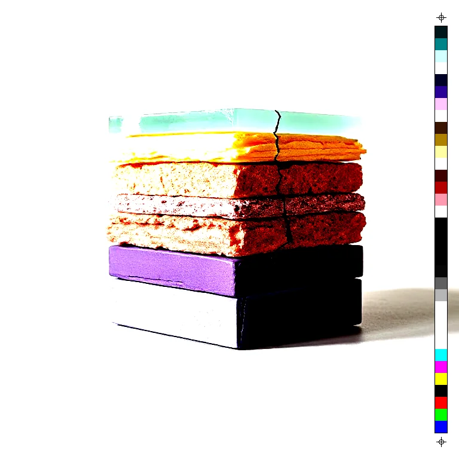

# Levels

<!-- generated:begin — preset-docs rewrites this block; write outside it -->
Classic black/white/gamma tonal remap via a single LUT.

| Control | Range | Default | What it does |
|---|---|---|---|
| Enabled | on or off | on | Turns the effect on or off without losing its settings. |
| Black point | 0 to 255, or more | 0 | Input value, 0 to 255, that becomes pure black. Raising it darkens the shadows. |
| White point | 0 to 255, or more | 255 | Input value, 0 to 255, that becomes pure white. Lowering it brightens the highlights. |
| Gamma | 0.1 to 5, or more | 1 | Midtone brightness. Above 1 lightens the midtones; below 1 darkens them. |
| Output black | 0 to 255, or more | 0 | Value, 0 to 255, that pure black becomes. Raising it lifts the shadows to grey, a faded matte look. |
| Output white | 0 to 255, or more | 255 | Value, 0 to 255, that pure white becomes. Lowering it dulls the highlights to grey. |

Slots: `mask`.
<!-- generated:end -->

## Using it

Remaps brightness on all three colour channels at once, using the same curve for each, so colours keep their balance.

- **Black point** is the input value that becomes pure black. Everything at or below it goes black, so raising it darkens and crushes the shadows.
- **White point** is the input value that becomes pure white. Everything at or above it goes white, so lowering it brightens and blows out the highlights.
- **Gamma** moves the midtones without moving black or white. Above 1 lightens them, below 1 darkens them.
- **Output black** is the value pure black becomes. Raising it lifts the shadows to grey, a faded, matte look.
- **Output white** is the value pure white becomes. Lowering it dulls the highlights to grey.

Under the Gamma field, a square curve shows the whole remap over a histogram of the picture as it arrives at Levels (luma in grey, red, green and blue overlaid). The line is the remap itself: flat at Output black up to the black point, the gamma curve between, flat at Output white from the white point on. Its two ends carry four of the fields: drag an end sideways to set Black point or White point, and up or down to set Output black or Output white. The number fields follow the drag, and typing in them moves the ends the same way. The middle point rides halfway between the ends; drag it up to lighten the midtones and down to darken them, and Gamma follows. Double-click adds nothing, and the ends can't cross, so the remap never inverts. A drag is one undo step, even when an end changes two fields, and Escape during the drag puts them back. The histogram changes when a modifier below Levels in the stack changes.

If White point is set at or below Black point, White point is treated as one above Black point, so the control never inverts. Output white works the same way against Output black. At the defaults (Output black 0, Output white 255) the result is the same as before these two fields existed.

Levels does not touch alpha.

## Recipes

- **Stretch a flat scan.** Black point 30 and White point 225 spread the tones that were sitting in the middle across the full range.
- **Move the cut.** Levels with Gamma 0.7, then Threshold at Level 127: the cut lands in a brighter part of the picture, so more of it goes black.

## Examples

<!-- examples:begin — `just examples` rewrites this block; write outside it -->

*Crushed hard: Levels (Black point 100, White point 175).*
<!-- examples:end -->
