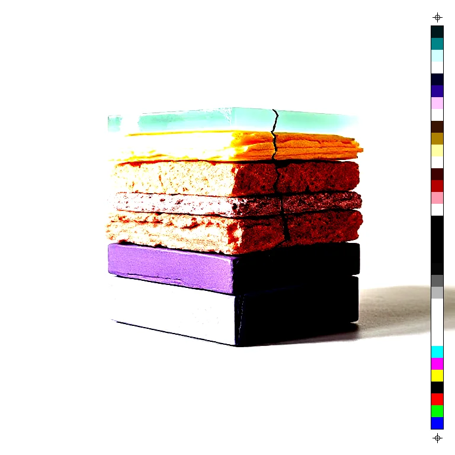

# Levels

<!-- generated:begin — rhizome-docs rewrites this block; write outside it -->
Classic black/white/gamma tonal remap via a single LUT.

| Control | Range | Default | What it does |
|---|---|---|---|
| Enabled | on or off | on | Turns the effect on or off without losing its settings. |
| Black point | 0 to 255, or more | 0 | Input value, 0 to 255, that becomes pure black. Raising it darkens the shadows. |
| White point | 0 to 255, or more | 255 | Input value, 0 to 255, that becomes pure white. Lowering it brightens the highlights. |
| Gamma | 0.1 to 5, or more | 1 | Midtone brightness. Above 1 lightens the midtones; below 1 darkens them. |

Slots: `mask`.
<!-- generated:end -->

## What it's for

Remaps brightness on all three colour channels at once, using the same curve for each, so colours keep their balance.

- **Black point** is the input value that becomes pure black. Everything at or below it goes black, so raising it darkens and crushes the shadows.
- **White point** is the input value that becomes pure white. Everything at or above it goes white, so lowering it brightens and blows out the highlights.
- **Gamma** moves the midtones without moving black or white. Above 1 lightens them, below 1 darkens them.

If White point is set at or below Black point, White point is treated as one above Black point, so the control never inverts.

Levels does not touch alpha.

## Recipes

- **Stretch a flat scan.** Black point 30 and White point 225 spread the tones that were sitting in the middle across the full range.
- **Move the cut.** Levels with Gamma 0.7, then Threshold at Level 127: the cut lands in a brighter part of the picture, so more of it goes black.

## Examples

<!-- examples:begin — `just examples` rewrites this block; write outside it -->

*Crushed hard: Levels (Black point 100, White point 175).*
<!-- examples:end -->
