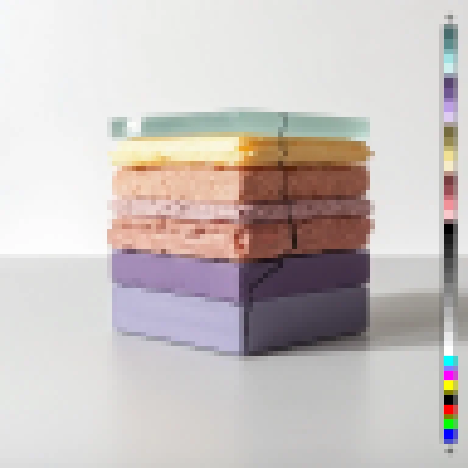
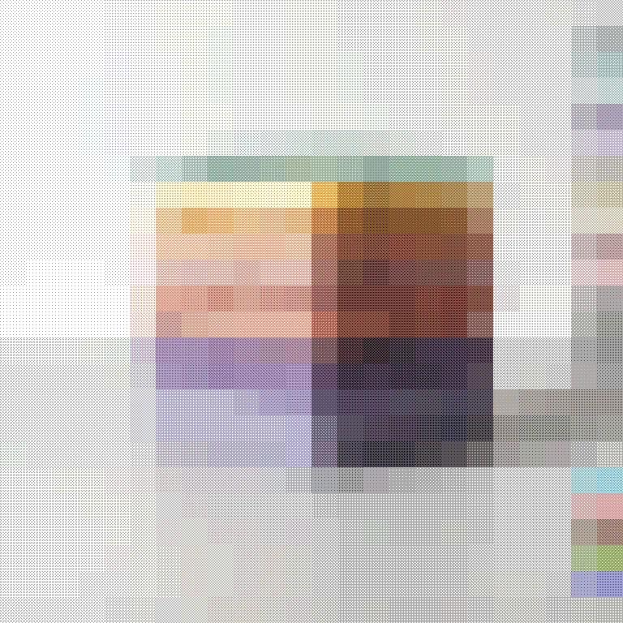

# Pixelate

<!-- generated:begin — rhizome-docs rewrites this block; write outside it -->
Flat-mean square-cell mosaic — each cell renders as one solid colour.

| Control | Range | Default | What it does |
|---|---|---|---|
| Enabled | on or off | on | Turns the effect on or off without losing its settings. |
| Cell size | 1 to 256, or more | 8 | Size of each mosaic cell in document pixels. Larger is blockier. |

Slots: `mask`.
<!-- generated:end -->

## What it's for

Splits the picture into square cells and fills each with its average colour. Cell size is in document pixels and the preview scales it, so the blocks stay the same proportion of the picture at any resolution. At 1 nothing happens.

**Alpha keeps its original detail.** Only colour is blocked; a cutout keeps its smooth outline. Transparent pixels contribute no colour to a cell, so the edge of a cutout does not pick up black from behind it.

At the right and bottom, when the picture isn't a whole number of cells wide, the last cells are narrower and average only the pixels they cover.

## Recipes

- **Low-res.** Pixelate with Cell size 12, then Colour Crush with Bits 3 and Dither on.
- **Redacted.** Pixelate with Cell size 24 on a masked modifier, with a vector layer as the mask, to block out one area.

## Examples

<!-- examples:begin — `just examples` rewrites this block; write outside it -->

*Defaults.*

*Low-res: Pixelate (Cell size 32), then Colour Crush (Bits 2, Dither on).*
<!-- examples:end -->
