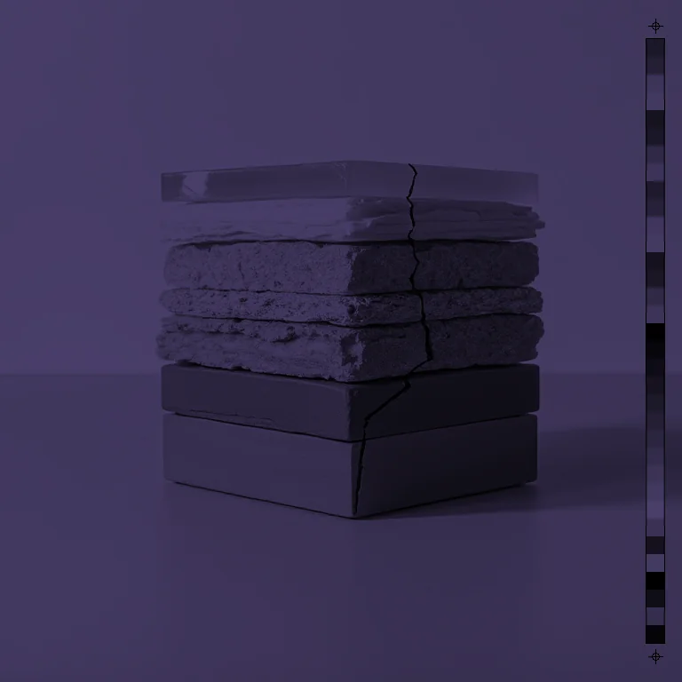
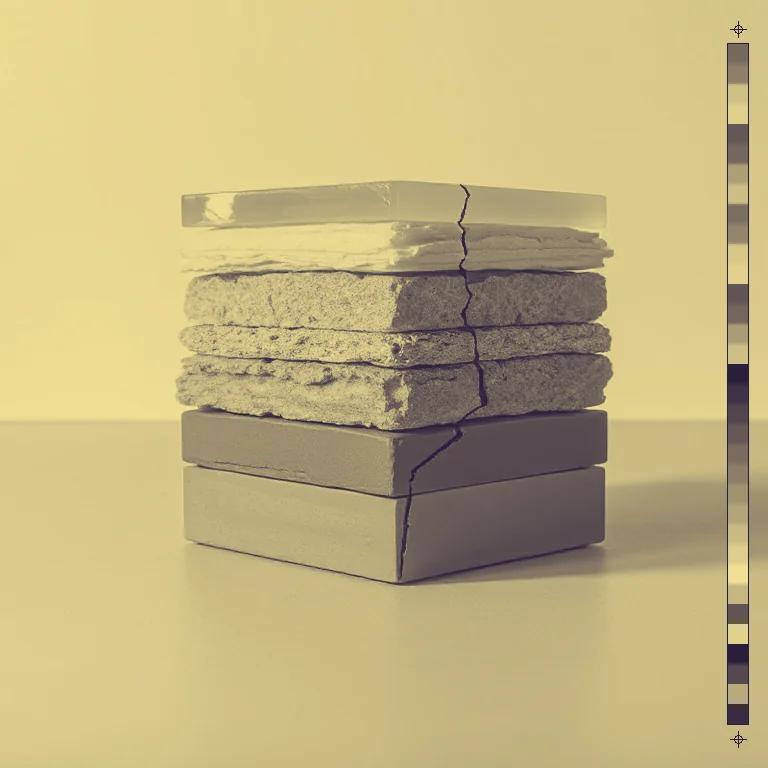

# Recolour

<!-- generated:begin — preset-docs rewrites this block; write outside it -->
Remap luminance onto an ordered 2-4 colour ramp — the duotone/tritone workhorse.

| Control | Range | Default | What it does |
|---|---|---|---|
| Enabled | on or off | on | Turns the effect on or off without losing its settings. |
| Stop 1 | text | #000000 | Colour for the darkest tones. |
| Stop 2 | text | #4a3f6b | Second colour in the ramp, dark to light. With 2 stops it is the lightest colour. |
| Stop 3 | text | #b06a4a | Third colour in the ramp. Used when Stops is 3 or 4; with 3 stops it is the lightest colour. |
| Stop 4 | text | #ffffff | Lightest colour in the ramp. Only used when Stops is 4. |
| Stops | 2 to 4, or more | 2 | How many ramp colours are used, 2 to 4. They are spaced evenly from dark to light. |
| Blend | 0 to 1, or more | 1 | How strongly the ramp replaces the original colours. 0 leaves the image unchanged; 1 is a full remap. |
| Keep brightness | on or off | off | Rescales the remapped colours so each pixel keeps its original brightness. |

Slots: `mask`.
<!-- generated:end -->

## Using it

Maps brightness onto a ramp of two to four colours. The darkest pixels take Stop 1, the lightest take the last stop in use, and everything between is blended along the ramp. The original hues are discarded: only how bright each pixel is decides its colour.

- **Stops** is how many colours are in the ramp, 2 to 4, spaced evenly from dark to light. Two is a duotone, three a tritone.
- **Stop 1 to Stop 4** are the colours, darkest first. Stops past the count are ignored.
- **Blend** mixes the remap with the original: 0 changes nothing, 1 is the full ramp.
- **Keep brightness** rescales the result so each pixel has the brightness it started with. It keeps the picture's light and dark structure intact, and the ramp colours you set shift in brightness to do it.

The stop colours are set up for four stops: Black, a dark purple, a clay red and white. At the default of 2 stops the lightest colour is Stop 2, the purple, so the picture comes out dark. Set Stop 2 to the colour you want the lights to become.

Alpha is untouched.

## Recipes

- **Duotone.** Stops 2, Stop 1 a deep navy, Stop 2 a pale cream.
- **Tritone.** Stops 3: Stop 1 near black, Stop 2 a mid red, Stop 3 a warm white. The mid red lands on the midtones.
- **Two-colour print.** Threshold at Level 127, then Recolour with Stops 2 and two ink colours.

## Examples

<!-- examples:begin — `just examples` rewrites this block; write outside it -->

*Defaults.*

*Shard duotone: Recolour (Stops 2, Stop 1 #2a1f3d, Stop 2 #f1e094).*
<!-- examples:end -->
