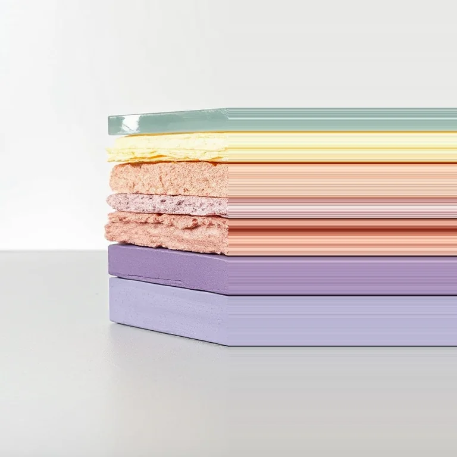
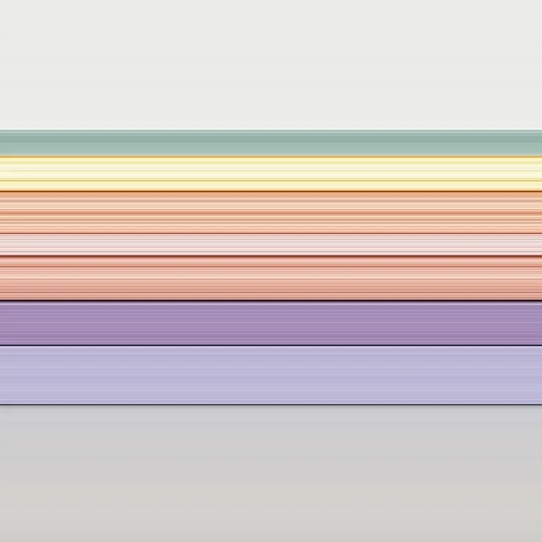

# Smear

<!-- generated:begin — preset-docs rewrites this block; write outside it -->
The scanner head stalled: sample one row or column and repeat it across the frame.

| Control | Range | Default | What it does |
|---|---|---|---|
| Enabled | on or off | on | Turns the effect on or off without losing its settings. |
| Direction | h, v | h | h repeats a sampled column sideways; v repeats a sampled row up and down. |
| Mode | forward, both, backward | forward | Which side of the sampled line is overwritten: forward (right or down), backward (left or up), or both (the whole frame). |
| Position | 0 to 1, or more | 0.5 | Where the sampled column or row sits, from 0 (left or top) to 1 (right or bottom). |
| Keep silhouette | on or off | off | Only recolours pixels that are already visible, so the shape's outline does not change. |

Slots: `mask`.
<!-- generated:end -->

## Using it

A scanner head that stalled: it read one line of the picture and kept repeating it. One row or column of the picture is picked and copied across the frame as streaks.

- **Direction** h picks a column and repeats it sideways, so the streaks run left and right. v picks a row and repeats it up and down.
- **Position** is where the line is picked, from 0 (left or top) to 1 (right or bottom). It is a share of the picture, so it lands on the same line at any preview size.
- **Mode** is which side of the line is overwritten. forward overwrites from the line onward (rightward for h, downward for v) and leaves the other side alone. backward is the mirror. both replaces the whole frame with the line, and nothing of the original is left.
- **Keep silhouette** limits the smear to pixels that were already visible, and leaves alpha alone, so the outline of a cutout does not change. Off, the line's alpha is copied too: a transparent line erases what it covers, and a cutout's shape is replaced by the line's.

Where the picked line is transparent and Keep silhouette is on, nothing is written, so there are no black bands from transparent pixels.

## Recipes

- **Scanner stall.** Smear with Direction h, Mode forward, Position 0.6, on a photo.
- **Smeared both sides.** Two Smear modifiers: Direction h, Mode backward, Position 0.25, then Direction h, Mode forward, Position 0.75. The middle half stays, with streaks at both edges.
- **Recoloured cutout.** Smear with Keep silhouette on, Direction v, Mode both, Position 0.5 on a cutout: the outline holds and the colours become one row stretched down.

## Examples

<!-- examples:begin — `just examples` rewrites this block; write outside it -->

*Defaults.*

*Scanner stall: Smear (Direction h, Mode both, Position 0.45).*
<!-- examples:end -->
