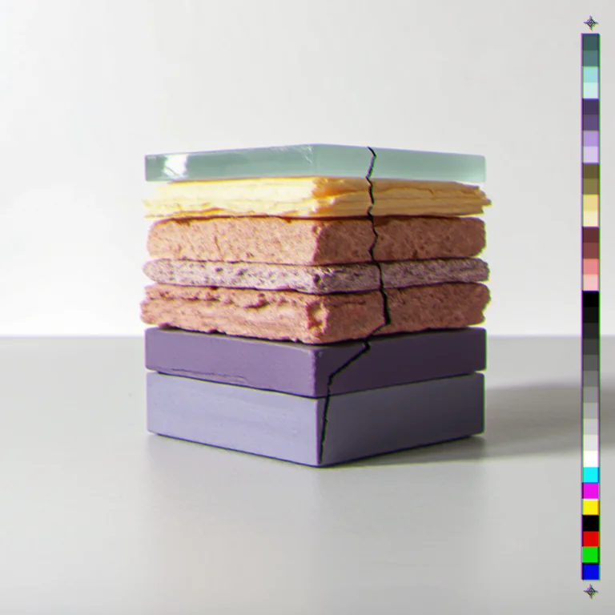
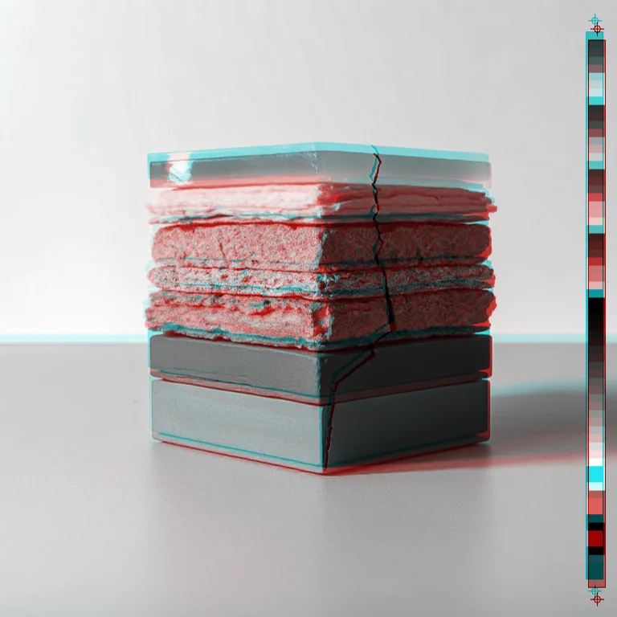

# Dye Transfer

<!-- generated:begin — preset-docs rewrites this block; write outside it -->
Dye-transfer colour from old three-strip and two-strip film: saturated reds, teal-cyans and slightly unreal skin, with the colour records printed a touch out of register.

| Control | Range | Default | What it does |
|---|---|---|---|
| Enabled | on or off | on | Turns the effect on or off without losing its settings. |
| Process | two_strip, three_strip | three_strip | three_strip keeps red, green and blue records. two_strip has only red-orange and cyan-green records, so blues collapse toward cyan-green, as in the 1920s. |
| Dye density | 0 to 2, or more | 1.2 | How heavy the dyes are. Higher gives deeper, more saturated colour and darker shadows; 1 is a plain print and 0 is clear film (white). |
| Cross-talk | 0 to 1, or more | 0.25 | How much each dye bleeds into its neighbours. Higher softens colour separation and blends hues together; 0 keeps the dyes separate. |
| Fringe | 0 to 8, or more | 1.5 | Largest random shift of each colour record, in document pixels. Higher gives wider coloured halos on edges; 0 keeps the records aligned. |
| Amount | 0 to 1, or more | 0.8 | How much of the effect is mixed in. 0 leaves the image unchanged; 1 is the full dye-transfer result. |
| Seed | 0 to 2147483647, or more | 0 | Changes the direction each record shifts without changing the fringe width. |

Slots: `mask`.
<!-- generated:end -->

## Using it

A rebuild of the picture in the way old dye-transfer prints made colour. It is not a tint: the picture is split into colour records, turned into cyan, magenta and yellow dyes, and printed back together.

**The process.** The cameras behind early three-strip film used a beam splitter to expose a separate black-and-white negative for each colour record. Dyes made from those negatives were transferred onto one print. Three-strip film recorded red, green and blue. The earlier two-strip film recorded only a red-orange record and a cyan-green one, so it had no true blue.

- **Process**: three_strip keeps three records. two_strip keeps two, and the picture is rebuilt from red and cyan-green alone, so blues collapse toward cyan-green.
- **Dye density** is how heavy the dyes are. On three_strip at 1, with Cross-talk and Fringe at 0, the picture comes out as it went in. Above 1 the colours deepen and saturate and the shadows darken, and neutrals get slightly darker too, because nothing makes the brightness up. Below 1 the dyes go thin and pale. At 0 the film is clear and the result is white.
- **Cross-talk** is how much each dye bleeds into its neighbours. At 0 the dyes stay separate; higher gives softer, blended hues.
- **Fringe** is the largest random shift of each colour record, in document pixels, in each direction. The records print slightly out of register, so hard edges pick up coloured halos. At 0 they line up. It is measured in document pixels, so a preview shows the same proportion as the full render.
- **Amount** blends the result with the original. At 1 it is the full dye-transfer picture; the default 0.8 keeps some of the original.
- **Seed** changes the direction each record shifts without changing how far.

Alpha is untouched. On a cutout the colours shift but the outline does not.

## Recipes

- **Three-strip.** The defaults on a daylight photo: deeper, more saturated colour and a faint coloured fringe on edges.
- **Two-strip.** Process two_strip, Dye density 1, Cross-talk 0.15, Amount 1. Everything lands between red and cyan-green.
- **Heavy misprint.** Dye density 1.4, Fringe 5, Amount 1, then Grain with Amount 0.1.
- **Lift after.** Dye Transfer at Dye density 1.6, then Levels with Gamma 1.2, to bring back the brightness the dyes took.

## Examples

<!-- examples:begin — `just examples` rewrites this block; write outside it -->

*Defaults.*

*Heavy two-strip misprint: Dye Transfer (Process two_strip, Dye density 1.6, Cross-talk 0.3, Fringe 8, Amount 1).*
<!-- examples:end -->
