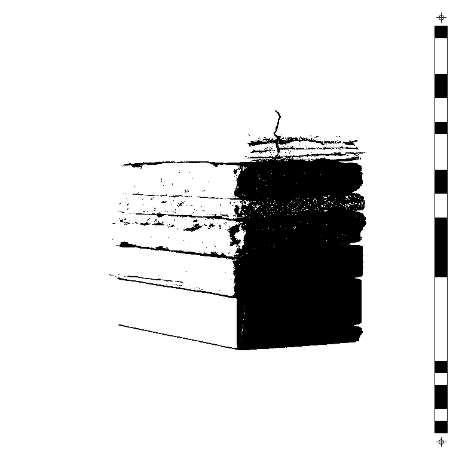
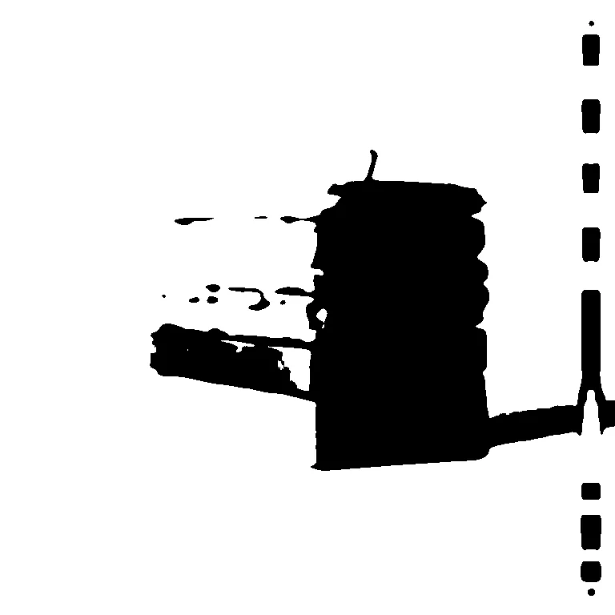

# Threshold

<!-- generated:begin — rhizome-docs rewrites this block; write outside it -->
Hard (or smoothstepped) luminance cut to pure black and white.

| Control | Range | Default | What it does |
|---|---|---|---|
| Enabled | on or off | on | Turns the effect on or off without losing its settings. |
| Level | 0 to 255, or more | 127 | Luminance cut-off, 0 to 255. Pixels at or above it turn white and the rest black, so higher gives more black. |
| Softness | 0 to 64, or more | 0 | Width of the soft transition around the level, in luminance steps. 0 is a hard cut. |

Slots: `mask`.
<!-- generated:end -->

## Using it

Every pixel becomes black or white depending on its brightness. Pixels at or above Level turn white and the rest black, so raising Level gives more black. The result is flat two-tone shapes with no greys.

**Softness** turns the hard cut into a short ramp of greys centred on Level. At 0 the edge is hard and jagged; at higher values it fades over that many brightness steps. A gradient in the picture gives a soft band; a sharp edge in the picture stays sharp.

**Alpha** is untouched, so a cutout keeps its outline and only its colour goes black and white.

## Recipes

- **Clean shapes.** Gaussian Blur at Radius 2, then Threshold at Level 127. The blur removes speckle first, so the black and white areas come out as solid blobs.
- **Two-colour print.** Threshold, then Recolour with Stops 2: Stop 1 is what the black becomes, Stop 2 what the white becomes.

## Examples

<!-- examples:begin — `just examples` rewrites this block; write outside it -->

*Defaults.*

*Clean shapes: Gaussian Blur (Radius 3), then Threshold (Level 150).*
<!-- examples:end -->
