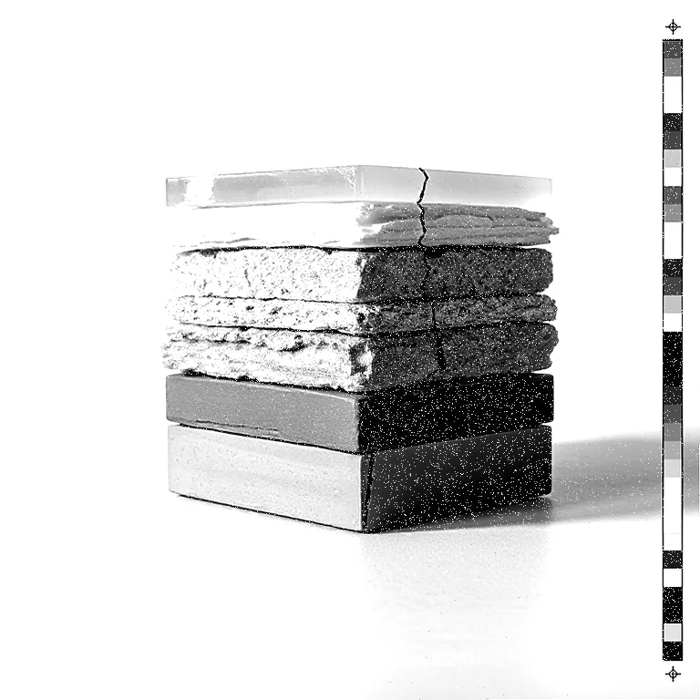
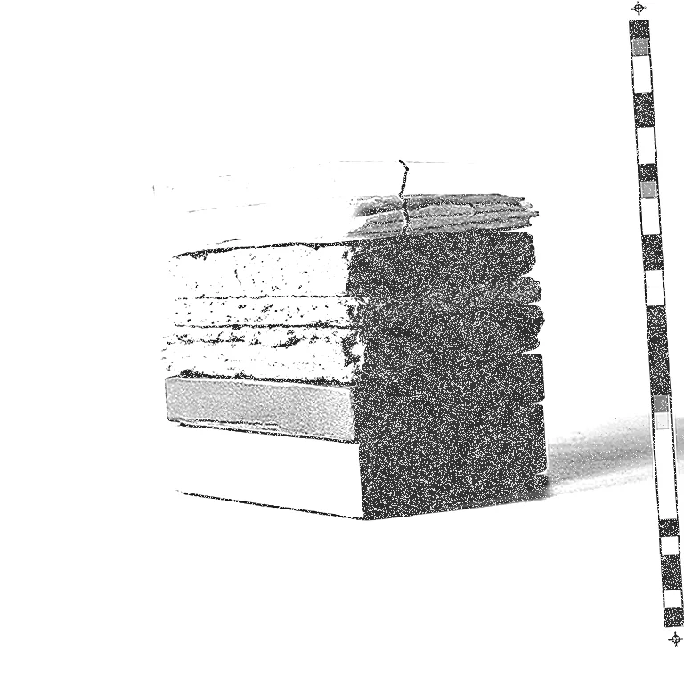

# Xerox

<!-- generated:begin — preset-docs rewrites this block; write outside it -->
Copy-of-a-copy generation loss: contrast blowout, threshold drift, skew, toner speckle.

| Control | Range | Default | What it does |
|---|---|---|---|
| Enabled | on or off | on | Turns the effect on or off without losing its settings. |
| Generations | 1 to 10, or more | 3 | Number of copy-of-a-copy passes. More passes mean harsher contrast and more drift. |
| Skew | 0 to 2, or more | 0.3 | Largest random tilt per pass, in degrees. 0 keeps the page straight. |
| Toner speckle | 0 to 1, or more | 0.15 | Amount of pale specks scattered through dark areas. Higher is more speckled; 0 is none. |
| Edge glow | 0 to 1, or more | 0.1 | Strength of the soft halo around edges. Higher is brighter; 0 is none. |
| Edge glow radius | 0.5 to 16, or more | 3 | Blur radius of the edge halo, in document pixels. Larger is a softer halo. |
| Keep colour | on or off | off | Leaves the image in colour instead of converting it to greyscale first. |
| Seed | 0 to 2147483647, or more | 0 | Changes the random pattern without changing its character. |

Slots: `mask`.
<!-- generated:end -->

## Using it

The picture as a photocopy of a photocopy. Each copy loses a little: the greys harden toward black and white, the page sits slightly off true, specks of toner drop out of the dark areas, and the edges pick up a faint glow. Run enough copies and little of the original is left.

It starts by turning the picture grey, since a photocopier prints one ink. **Keep colour** leaves it in colour.

- **Generations** is how many times it is copied, 1 to 10. Every pass widens the contrast around mid-grey a little more than the last, and moves the mid-grey point by a small random amount, so the exposure wanders. At 3 the contrast is roughly doubled. At 10 it is over five times, and much of the picture has gone to black or white.
- **Skew** is the largest random tilt per pass, in degrees. The tilts add up, so more generations drift further from square. At 0 the page stays straight. The corners that the tilt uncovers are white.
- **Toner speckle** scatters pale specks in the dark areas. The darker the area, the more specks. At 0 there are none.
- **Edge glow** adds a soft, bright halo around edges. **Edge glow radius** is how far it spreads, in document pixels.
- **Seed** changes the random tilts, drifts and specks.

**It acts on the colour, not the outline.** Alpha is untouched, so on a cutout the tilt moves the picture inside the layer's fixed outline. It suits full-frame pictures best.

## Recipes

- **Tired office copier.** Generations 4, Skew 0.5, Toner speckle 0.2, Edge glow 0.1.
- **Heavy contrast.** Generations 10, Skew 0, Toner speckle 0.4. Almost no greys survive.
- **Colour copy.** Keep colour on, Generations 2, Skew 0.3.
- **Running dry.** Xerox, then Ink Starved with Direction h, Starvation 0.6 and Banding 0.25: the copy fades toward the far side.

## Examples

<!-- examples:begin — `just examples` rewrites this block; write outside it -->

*Defaults.*

*Copy of a copy of a copy: Xerox (Generations 9, Skew 1.2, Toner speckle 0.5, Edge glow 0.4, Edge glow radius 6).*
<!-- examples:end -->
